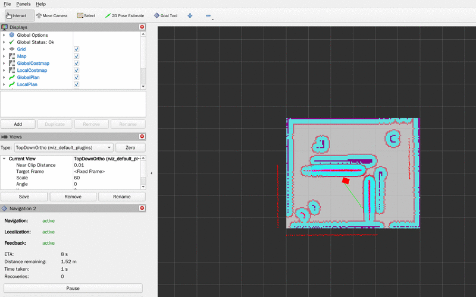

# navbot

基于 ROS2 Humble + Nav2 + slam_toolbox 的两轮差速小车导航项目。仿真跑 Gazebo Classic 11，真机接 STM32 底盘，URDF 模型两边复用。





> 车在 `navbot_room` 房间里沿方形路线走一圈，回到起点成环。
> 录制命令：`bash tools/env/record_navigation.sh square`（无头环境，脚本用 Xvfb 起虚拟屏跑 RViz）。

## 目录

- [系统组成](#系统组成)
- [目录结构](#目录结构)
- [环境准备](#环境准备)
- [仿真流程](#仿真流程)
- [脚本](#脚本)
- [配置说明](#配置说明)
- [真机路线](#真机路线)
- [已知问题](#已知问题)
- [相关文档](#相关文档)

## 系统组成

四个包，依赖单向，没有循环：

| 包 | 职责 | 状态 |
|---|---|---|
| `navbot_description` | URDF/xacro 模型，关节树、惯量、雷达支架 | 完成（7 link + 5 惯性宏） |
| `navbot_bringup` | launch 文件、Nav2 与 slam_toolbox 参数、Gazebo 世界、地图 | 完成 |
| `navbot_bridge` | 串口 ↔ ROS 话题桥接（Python 参照实现，448 行） | 完成，36 项测试 |
| `navbot_chassis` | **C++ 版同一节点**（rclcpp） | **骨架，5 个 TODO 未填** |

`navbot_bridge` 与 `navbot_chassis` 是**同一个节点的两种实现**，同时存在是故意的：
Python 版是标准答案，C++ 版写完后用它逐字段对照，行为不一致就是 C++ 版错了。

导航部分直接用 Nav2 官方 `bringup_launch.py`，自己只提供参数文件和地图。

底盘参数在三个地方必须保持一致，改一个要同步另两个：

- 轮距 0.16 m、轮半径 0.0325 m —— `navbot.xacro`
- `robot_radius: 0.20` —— `nav2_params.yaml` 代价地图
- `--wheel-sep` / `--wheel-radius` —— `fake_chassis.py`

## 目录结构

```
.
├── src/                            ROS2 工作空间（4 个包）
│   ├── navbot_description/         模型
│   │   ├── urdf/
│   │   │   ├── navbot.xacro           机器人本体（主文件，被下面两个引用）
│   │   │   ├── navbot.urdf.xacro      引用本体
│   │   │   └── navbot.gazebo.xacro    Gazebo 插件：雷达、底盘、差速器
│   │   ├── launch/display_navbot.launch.py
│   │   └── rviz/navbot_check.rviz
│   ├── navbot_bringup/             启动与配置
│   │   ├── launch/
│   │   │   ├── sim_navbot.launch.py     只起仿真，不含 Nav2
│   │   │   ├── slam_mapping.launch.py   建图
│   │   │   └── nav_bringup.launch.py    定位 + 导航
│   │   ├── config/{nav2_params,slam_toolbox_params}.yaml
│   │   ├── maps/navbot_room.{pgm,yaml}  地图（pgm 由 map_saver 生成）
│   │   ├── worlds/navbot_room.world     Gazebo 世界
│   │   └── rviz/navbot_{nav,slam}.rviz
│   ├── navbot_bridge/              串口桥接（Python 参照实现）
│   │   ├── navbot_bridge/chassis_bridge.py   O 帧 → /odom+TF+/joint_states；/cmd_vel → V 帧
│   │   ├── config/bridge_params.yaml         真机串口参数
│   │   └── launch/bringup_real.launch.py     真机启动
│   └── navbot_chassis/             C++ 版同一节点（rclcpp，骨架）
│       └── src/chassis_node.cpp
├── tools/                          不需要 ROS 技能树也能跑的工具
│   ├── verify/                     无硬件验收体系（5 脚本 / 2179 行）
│   │   ├── verify_e2e.sh              端到端 10 组判据
│   │   ├── fake_chassis.py            假底盘，可注入四类故障
│   │   ├── test_protocol.py           协议与运动学单测（44 项）
│   │   ├── crosscheck_bridge_functions.py  桥内纯函数逐值对拍（61 条）
│   │   └── sim_integration_check.py   仿真侧集成检查
│   ├── env/                        环境层
│   │   ├── setup_env.sh               一键重建（幂等，15~25 min）
│   │   ├── check_env.sh               环境体检
│   │   ├── check_sim.sh               仿真四道门体检
│   │   ├── record_navigation.sh       无头环境录导航 GIF
│   │   ├── diag_ros_apt_key.sh        apt 源与密钥专项诊断
│   │   └── audit_scripts.sh           脚本自审
│   └── diag/                       排障实测沉淀
│       ├── fastdds_udp_only.xml       容器里绕开 SHM，强制 UDP
│       └── auto_scan.py               自动走位 + 全向扫描
├── firmware/                       真机
│   ├── navbot_chassis/             STM32 底盘固件（CubeMX 工程，25 个 TODO 未填）
│   └── navbot_protocol.md          通信协议 v1（改代码前先看这份）
├── docs/                           14 份文档 + 演示动图
└── README.md
```

脚本的用途见[脚本](#脚本)一节。

## 环境准备

Ubuntu 22.04 + ROS2 Humble。一条命令重建环境层（装包、配国内源、编译工作空间），15~25 分钟，幂等可重复跑：

```bash
bash tools/env/setup_env.sh          # 在仓库任意位置均可，工作空间根自动探测
```

装完先体检一次：

```bash
bash tools/env/check_env.sh
```

脚本不写死工作空间路径：优先用环境变量 `NAVBOT_WS`，否则从脚本位置向上找含 `src/` 的目录，
所以 `~/navbot_ws`、`/mnt/workspace`（云实例）和自定义位置都能直接跑。

装出来的包数应该是 211（按需安装，不是 desktop 全套，不必追求 300+）。

## 仿真流程

四个阶段各对应一个 launch，前进顺序是固定的。

### ① 看模型

```bash
source ~/.ros_env
ros2 launch navbot_description display_navbot.launch.py
```

### ② 让车动起来

```bash
ros2 launch navbot_bringup sim_navbot.launch.py gui:=false
```

无头环境加 `gui:=false`。另开终端遥控：

```bash
ros2 run teleop_twist_keyboard teleop_twist_keyboard
ros2 topic hz /scan    # 约 10 Hz
ros2 topic hz /odom    # 约 50 Hz
```

`/odom` 的 `frame_id` 应该是 `odom`，`child_frame_id` 是 `base_footprint`。

### ③ 建图

```bash
ros2 launch navbot_bringup slam_mapping.launch.py use_sim_time:=true
```

遥控车走一圈覆盖房间，确认 `/map` 有数据后存图：

```bash
ros2 topic hz /map      # 约 0.2 Hz，确认有帧再存
ros2 run nav2_map_server map_saver_cli -f navbot_room
```

存出来的 `.pgm` 和 `.yaml` 放进 `src/navbot_bringup/maps/`。

### ④ 导航

```bash
ros2 launch navbot_bringup nav_bringup.launch.py use_sim_time:=true
```

RViz 里先点 **2D Pose Estimate** 给初始位姿，再点 **Nav2 Goal** 发目标点。不依赖 RViz 的话：

```bash
ros2 action send_goal /navigate_to_pose nav2_msgs/action/NavigateToPose \
  "{pose: {header: {frame_id: map}, pose: {position: {x: 1.5, y: 1.0, z: 0.0}, orientation: {w: 1.0}}}}"
```

导航模式和建图模式互斥，两者同时跑会争抢 `map → odom`，表现为 TF 抖动、位置乱跳。

### 无头环境录 GIF


需要图形界面但没有显示器时，用虚拟屏跑 RViz 再截图合成：

```bash
bash record_navigation.sh square    # 走方形路线成环，输出 navigation.gif
```
Gazebo 跟不上真实时间（RTF < 1），车按仿真时间走而截图按真实时间拍，整段导航在墙上要花几分钟。脚本用「跑完为止」模式而非固定帧数。

## 脚本

全部在 `tools/` 下，分三类。

**环境层**（`tools/env/`）

| 脚本 | 用途 |
|---|---|
| `setup_env.sh` | 环境一键重建（装包、配源、编译），路径自动探测 |
| `check_env.sh` | 3 秒体检，输出缺什么和对应命令；`--fix` 自动补 |
| `check_sim.sh` | 仿真层四道门体检（spawn / 话题 / TF）；`--diag` 只读快照 |
| `record_navigation.sh` | 无头环境录导航 GIF；`--diag` 现场诊断 |
| `diag_ros_apt_key.sh` | apt 源与 GPG 密钥专项诊断 |
| `audit_scripts.sh` | 脚本自审，抓 `bash -n` 查不到的错 |

**验收层**（`tools/verify/`）—— 见[无硬件也能验](#无硬件也能验)。

**排障层**（`tools/diag/`）

| 文件 | 用途 |
|---|---|
| `fastdds_udp_only.xml` | 容器里 `/dev/shm` 不可用时强制 UDP，绕开 SHM 段创建失败 |
| `auto_scan.py` | 自动走位 + 每点原地转一圈，比边走边转的建图质量高 |

改完 shell 脚本建议跑一次 `audit_scripts.sh`。它检查两类 `bash -n` 查不出的问题：命令名与引号之间缺空格（语法合法、运行时才炸），以及管道退出码被 `tee`/`sed` 吞掉导致错误分支永不触发。

## 配置说明

### launch 参数

| launch | 参数 | 默认 | 说明 |
|---|---|---|---|
| `sim_navbot` | `gui` | `true` | 无头环境设 `false` |
| | `use_sim_time` | `true` | 仿真必须 true |
| | `world` | `navbot_room.world` | Gazebo 世界 |
| `slam_mapping` | `use_sim_time` | `true` | |
| | `use_rviz` | `true` | |
| | `slam_params_file` | `slam_toolbox_params.yaml` | |
| `nav_bringup` | `map` | `maps/navbot_room.yaml` | |
| | `params_file` | `config/nav2_params.yaml` | |
| | `use_sim_time` | `true` | 真机改 `false` |
| | `use_rviz` | `true` | |
| | `autostart` | `true` | 生命周期节点自动激活；调试时可设 `false` 手动逐个激活 |
| `display_navbot` | `use_sim_time` | `true` | |
| | `use_rviz` | `true` | |

### 关键配置项

`config/nav2_params.yaml`：

| 项 | 值 | 说明 |
|---|---|---|
| `robot_radius` | 0.20 | 代价地图机器人半径，要大于车体半对角 |
| `max_vel_x` | 0.22 | 差速车不倒车，`min_vel_x` 为 0 |
| `max_vel_theta` | 1.0 | 原地旋转角速度 |
| `xy_goal_tolerance` | 0.15 | 位置容差 |
| `scan_topic` | `scan` | 无 `/scan` 前缀，适配 Gazebo 的相对话题名 |

`config/slam_toolbox_params.yaml`：

| 项 | 值 | 说明 |
|---|---|---|
| `resolution` | 0.05 | 必须与地图 yaml 的 `resolution` 一致，否则地图被缩放、路径撞墙 |
| `odom_frame` / `base_frame` | `odom` / `base_footprint` | |
| `enable_interactive_mode` | `true` | 允许在 RViz 里手动拉回环 |

`maps/navbot_room.yaml` 的 `origin` 由 map_saver 自动填写，不要手改；`negate` 必须为 0，搞反了 Nav2 会把空地当障碍。

## 真机路线

真机用 `navbot_bridge` 的 `chassis_bridge` 节点替代 Gazebo，串口接 STM32 底盘。
上层（Nav2 / slam_toolbox / URDF）完全复用，**只换数据来源**。

```bash
# 真机启动（改 bridge_params.yaml 里的 port 指向实际串口）
ros2 launch navbot_bridge bringup_real.launch.py
# 或直接跑节点
ros2 run navbot_bridge chassis_bridge --ros-args \
  -p port:=/dev/ttyUSB0 -p wheel_separation:=0.16 \
  -p wheel_radius:=0.0325 -p encoder_ppr:=2112.0
```

### 数据流

```
STM32 ──O 帧(11字段,50Hz)──▶ chassis_bridge ──▶ /odom + TF(odom→base_footprint) + /joint_states
                              │
       ◀──V 帧(4字段,20Hz)──   ◀── /cmd_vel（差速逆解）
```

上行 O 帧 `O,seq,enc_l,enc_r,vel_l,vel_r,pwm_l,pwm_r,vbat_mv,tick_ms,temp_c100`，
下行 V 帧 `V,seq,vel_l,vel_r`，115200 8N1。协议全文见
[`firmware/navbot_protocol.md`](firmware/navbot_protocol.md)，**改协议前先看那份，两端字段必须同步**。

### 三个实现要点

| 要点 | 为什么 |
|---|---|
| 读串口在**独立线程** | `readline()` 阻塞，放 spin 线程等于把执行器掐停（实测：`/ping` 卡 5.1 s、Ctrl+C 退不掉） |
| 发布用**定时器 + 最新值** | 到达频率不可控，发布频率必须稳定；配合 0.5 s 超时防陈旧数据 |
| **三层异常**处理 | 连接层重连（日志节流）/ 数据层静默计数（绝不逐帧打印）/ 时效层超时停发（只警告一次） |

### 无硬件也能验

不必等硬件到货。`fake_chassis.py` 冒充 STM32，还能注入四类故障（死机、乱码、seq 停滞、零点漂移）：

```bash
./tools/verify/verify_e2e.sh         # 10 组 e2e 判据，一条命令跑完
```

链路：

```
fake_chassis.py ──写──> 虚拟串口 ──读──> chassis_bridge ──> /odom + TF + /joint_states
 (假 STM32)
```

5 个脚本、共 2179 行：

| 脚本 | 行数 | 验什么 |
|---|---|---|
| `verify_e2e.sh` | 646 | 10 组端到端判据：话题频率、TF 树、坐标系命名、故障注入、陈旧数据停发、install 新鲜度 |
| `test_protocol.py` | 370 | 协议帧编解码与 CRC，44 项单测 |
| `fake_chassis.py` | 385 | 假 STM32：按协议吐里程计帧、收速度帧 |
| `crosscheck_bridge_functions.py` | 417 | 桥内纯函数 vs 参考实现逐值对拍（61 条，含物理锚点） |
| `sim_integration_check.py` | 361 | 仿真侧集成检查 |

**按环境选判据**（这一步容易踩空）：

| 环境 | 用哪个 | 说明 |
|---|---|---|
| 普通 Ubuntu（有 `/dev/pts`） | `tools/verify/verify_e2e.sh` | 走真实虚拟串口，10 组全绿 |
| 容器 / CI（无 pty） | `src/navbot_bridge/test/test_bridge_offline.py` | mock 串口驱动同一个节点，18 项全绿 |

`verify_e2e.sh` 检测到没有 pty 时会自动降级到 TCP 回环并提示切到 offline 测试，不会静默假失败
——**这是踩过坑之后加的**（容器里 `out of pty devices` 曾被误判成代码 bug）。

本机实测（2026-10-29，无 pty 的沙箱）：

```
crosscheck_bridge_functions.py  →  61 通过 / 0 失败
test_bridge_offline.py          →  18 通过 / 0 失败
verify_e2e.sh                   →  16 通过 / 4 失败 / 3 跳过
                                   4 项失败全在串口层，有 pty 的机器上不出现
```

> 桥梁节点实测记录见 [`docs/S20_复盘_chassis_bridge实现.md`](docs/S20_复盘_chassis_bridge实现.md)：
> `/odom` 49.923 Hz、乱码注入后进程存活且日志仅 2 行、`verify_e2e.sh` 通过 21 / 失败 0。

底盘固件在 [`firmware/navbot_chassis.c`](firmware/navbot_chassis.c)（骨架，25 个 TODO 未填；
本项目走软件方向，固件不作要求）。

## 已知问题

**Gazebo 版本**：Humble 对应 Gazebo Classic 11，包名 `gazebo`。不要装 `ros-humble-ros-gz`（那是新版的桥接包），URDF 里的 `<gazebo>` 标签会找不到插件。

**无头环境 `/scan` 空**：`gpu_ray` 依赖 GPU 渲染，无头环境被禁。`setup_env.sh` 会自动把 xacro 里的 `gpu_ray` 改成 `ray`。

**`joint_state_publisher` 挂起**：它是 ament_python 包，没有 Config.cmake，不能在 CMakeLists 里 `find_package`。launch 里要显式传 `robot_description` 参数。

**`tf2_echo` 属于 `tf2_ros`**：`ros2 run tf2_tools tf2_echo` 会报 No executable found，`tf2_tools` 里只有 `view_frames`。

**`ament_lint_auto` 缺包**：`ros2 pkg create` 生成的 CMakeLists 默认 `find_package(ament_lint_auto REQUIRED)`，而 colcon build 默认 `BUILD_TESTING=ON`，不装它编译必挂。

**`joint_state_publisher` 依赖降级**：它是运行时依赖，留在 `package.xml` 的 `<exec_depend>`，不要放进 `<depend>`。

**`navbot_chassis` 只有骨架**：5 个 TODO 全空，`chassis_node` 能 build、能 spin，但没有业务逻辑。它存在的意义是给 C++ 版重写留容器，不是已交付功能。

**G1 未达成**：`sim_all.launch.py` 不存在，仿真 + 导航要开三个终端，没有「一条命令 + 连发 5 点 + 5/5 到达」的复现记录。这是当前简历上最大的空洞。

**实车雷达驱动未安装**：`rplidar_ros` / `sllidar_ros2` 都不在 `ros2 pkg list` 里，真机上雷达前必须先补。

## 相关文档

| 文档 | 内容 |
|---|---|
| [P3 保姆级项目文档](docs/P3_ROS2自主导航移动机器人_保姆级项目文档.md) | 主线教程，阶段 A→D |
| [A4 三包架构说明](docs/A4_三包架构说明.md) | 架构拆解 |
| [A3 URDF 建模概念清单](docs/A3_URDF建模概念清单.md) | 建模概念与惯量宏 |
| [00 环境一键安装](docs/00_环境一键安装文档.md) | 环境配置与踩坑 |
| [A5 知识概念全解](docs/A5_知识概念全解.md) | 概念答疑 |
| [G1 Git 推送步骤](docs/G1_Git推送到GitHub详细步骤.md) | 推到 GitHub |

环境层的问题基本都沉淀在 `setup_env.sh` 文件头和 `docs/00_环境一键安装文档.md` 的「常见坑」章节。
