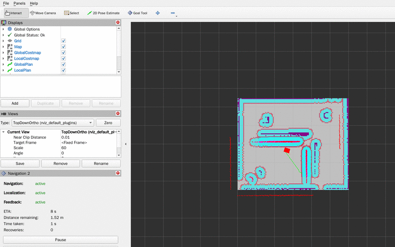

# navbot

基于 ROS2 Humble + Nav2 + slam_toolbox 的两轮差速小车导航项目。仿真跑 Gazebo Classic 11，真机接 STM32 底盘，URDF 模型两边复用。

两张仿真地图，用途不同：

| 地图 | 尺寸 | 用来看什么 |
|---|---|---|
| `navbot_room` | 6 × 5 m，1 房间 + 2 段隔断 | 单个机制：窄缝（0.655 m）、原地转、膨胀参数 |
| `navbot_house` | 15.2 × 10.7 m，5 房间 + 成环走廊 | 复杂路径：跨房间、绕远 vs 抄近、门洞通过 |





> 车在 `navbot_room` 房间里沿方形路线走一圈，回到起点成环。
> 录制命令：`bash tools/env/record_navigation.sh square`（无头环境，脚本用 Xvfb 起虚拟屏跑 RViz）。

## 目录

- [系统组成](#系统组成)
- [目录结构](#目录结构)
- **环境准备**
- [仿真流程](#仿真流程)
- [复杂地图](#复杂地图navbot_house)
- [脚本](#脚本)
- [配置说明](#配置说明)
- [真机路线](#真机路线)
- [已知问题](#已知问题)
- [相关文档](#相关文档)

## 系统组成

四个包，依赖单向，没有循环：

| 包 | 职责 | 状态 |
|---|---|---|
| `navbot_description` | URDF/xacro 模型，关节树、惯量、雷达支架 | 完成（7 link + 5 惯性宏） |
| `navbot_bringup` | launch 文件、Nav2 与 slam_toolbox 参数、Gazebo 世界、地图 | 完成 |
| `navbot_bridge` | 串口 ↔ ROS 话题桥接（Python 参照实现，448 行） | 完成，36 项测试 |
| `navbot_chassis` | **C++ 版同一节点**（rclcpp） | 完成，16 项单测 + 端到端 50 Hz |

`navbot_bridge` 与 `navbot_chassis` 是**同一个节点的两种实现**，同时存在是故意的：
Python 版是标准答案，C++ 版写完后用它逐字段对照，行为不一致就是 C++ 版错了。
C++ 版已完成，实现说明与踩坑记录见 [`src/navbot_chassis/NOTES_P1.md`](src/navbot_chassis/NOTES_P1.md)。

导航部分直接用 Nav2 官方 `bringup_launch.py`，自己只提供参数文件和地图。

底盘参数在三个地方必须保持一致，改一个要同步另两个：

- 轮距 0.16 m、轮半径 0.0325 m —— `navbot.xacro`
- `footprint` 矩形 0.30×0.24（±0.15, ±0.12）—— `nav2_params.yaml` 两处代价地图
  ★ 用矩形而不是 `robot_radius: 0.20`：外接圆会把车算胖 7.2 cm，
  在 0.655 m 的缝 S 里等于堵死 14.4 cm —— 详见 `docs/S32_从下面过不去.md`
- `--wheel-sep` / `--wheel-radius` —— `fake_chassis.py`

## 目录结构

```
.
├── src/                            ROS2 工作空间（4 个包）
│   ├── navbot_description/         模型
│   │   ├── urdf/
│   │   │   ├── navbot.xacro           机器人本体（主文件，被下面两个引用）
│   │   │   ├── navbot.urdf.xacro      引用本体
│   │   │   └── navbot.gazebo.xacro    Gazebo 插件：雷达、底盘、差速器
│   │   ├── launch/display_navbot.launch.py
│   │   └── rviz/navbot_check.rviz
│   ├── navbot_bringup/             启动与配置
│   │   ├── launch/
│   │   │   ├── sim_navbot.launch.py     只起仿真，不含 Nav2（x/y/yaw 可换出生点）
│   │   │   ├── slam_mapping.launch.py   建图
│   │   │   └── nav_bringup.launch.py    定位 + 导航
│   │   ├── config/nav2_params.yaml        房间用（基线）
│   │   ├── config/nav2_params_house.yaml  房子用（inflation 0.32 + SMAC cp=120）
│   │   ├── config/slam_toolbox_params.yaml
│   │   ├── maps/navbot_room.{pgm,yaml}  房间地图（pgm 由 map_saver 生成）
│   │   ├── maps/navbot_house.{pgm,yaml} 房子地图（几何真值图，world_to_map.py 直出）
│   │   ├── worlds/navbot_room.world     Gazebo 世界（自建小房间）
│   │   ├── worlds/navbot_house.world    Gazebo 世界（TurtleBot3 官方 5 房间，已内联）
│   │   └── rviz/navbot_{nav,slam}.rviz  RViz 视图
│   ├── navbot_bridge/              串口桥接（Python 参照实现）
│   │   ├── navbot_bridge/chassis_bridge.py   O 帧 → /odom+TF+/joint_states；/cmd_vel → V 帧
│   │   ├── config/bridge_params.yaml         真机串口参数
│   │   └── launch/bringup_real.launch.py     真机启动
│   └── navbot_chassis/             C++ 版同一节点（rclcpp，16 单测）
│       ├── include/navbot_chassis/
│       │   ├── protocol.hpp             协议层接口（纯逻辑，零 ROS 依赖）
│       │   └── chassis_node.hpp         节点类声明（状态一览）
│       ├── src/
│       │   ├── protocol.cpp             O/V 帧编解码 + FrameReader
│       │   └── chassis_node.cpp         rclcpp 节点：读线程 / 定时发布 / 三层异常
│       ├── test/test_protocol.cpp       16 个 gtest（期望值取自协议 §8 golden vector）
│       ├── check_progress.sh            一键看测试进度（通过 N/15）
│       └── NOTES_P1.md                  实现说明、契约矛盾、踩坑记录
├── tools/                          不需要 ROS 技能树也能跑的工具
│   ├── verify/                     无硬件验收体系（16 脚本 / 5305 行）
│   │   ├── verify_e2e.sh              端到端 10 组判据
│   │   ├── chassis_cpp_e2e.sh         C++ 版桥节点端到端（假底盘 → 虚拟串口 → /odom）
│   │   ├── fake_chassis.py            假底盘，可注入四类故障
│   │   ├── test_protocol.py           协议与运动学单测（44 项）
│   │   ├── crosscheck_bridge_functions.py  桥内纯函数逐值对拍（61 条）
│   │   ├── sim_integration_check.py   仿真侧集成检查
│   │   ├── check_controller.py        控制器链离线闸门（11 项）
│   │   ├── check_limits.py            安全阈值闸门（7 项）
│   │   ├── inject_faults.py           闸门自证：6 种坏配置必须被抓到
│   │   ├── world_to_map.py            ★ SDF 世界 → Nav2 占据栅格地图（真值图）
│   │   ├── path_select.py             ★ 多规划器算同一批路径并打分（规划层筛选）
│   │   ├── nav_route.py               ★ 按 JSON 路线逐点导航，记录耗时/误差
│   │   ├── routes_house.json          房子图的 6 点巡检路线
│   │   └── sim_fullchain/             实时联调工具（live.sh / nav_patrol / 扫码建图，38 文件）
│   ├── env/                        环境层
│   │   ├── setup_env.sh               一键重建（幂等，15~25 min）
│   │   ├── check_env.sh               环境体检
│   │   ├── check_hw.py                硬件勘察（只读）
│   │   ├── check_sim.sh               仿真四道门体检
│   │   ├── record_navigation.sh       无头环境录导航 GIF
│   │   ├── diag_ros_apt_key.sh        apt 源与密钥专项诊断
│   │   └── audit_scripts.sh           脚本自审
│   └── diag/                       排障实测沉淀
│       ├── fastdds_udp_only.xml       容器里绕开 SHM，强制 UDP
│       └── auto_scan.py               自动走位 + 全向扫描
├── firmware/                       真机
│   ├── navbot_chassis/             STM32 底盘固件（CubeMX 工程，19 个 TODO 未填）
│   └── navbot_protocol.md          通信协议 v1（改代码前先看这份）
├── docs/                           28 份文档 + 演示动图 + 仿真截图
└── README.md
```

脚本的用途见[脚本](#脚本)一节。

## 环境准备

Ubuntu 22.04 + ROS2 Humble。一条命令重建环境层（装包、配国内源、编译工作空间），15~25 分钟，幂等可重复跑：

```bash
bash tools/env/setup_env.sh          # 在仓库任意位置均可，工作空间根自动探测
```

装完先体检一次：

```bash
bash tools/env/check_env.sh
```

脚本不写死工作空间路径：优先用环境变量 `NAVBOT_WS`，否则从脚本位置向上找含 `src/` 的目录，
所以 `~/navbot_ws`、`/mnt/workspace`（云实例）和自定义位置都能直接跑。

装出来的包数应该是 211（按需安装，不是 desktop 全套，不必追求 300+）。

## 仿真流程

四个阶段各对应一个 launch，前进顺序是固定的。

### ① 看模型

```bash
source ~/.ros_env
ros2 launch navbot_description display_navbot.launch.py
```

### ② 让车动起来

```bash
ros2 launch navbot_bringup sim_navbot.launch.py gui:=false
```

无头环境加 `gui:=false`。另开终端遥控：

```bash
ros2 run teleop_twist_keyboard teleop_twist_keyboard
ros2 topic hz /scan    # 约 10 Hz
ros2 topic hz /odom    # 约 50 Hz
```

`/odom` 的 `frame_id` 应该是 `odom`，`child_frame_id` 是 `base_footprint`。

### ③ 建图

```bash
ros2 launch navbot_bringup slam_mapping.launch.py use_sim_time:=true
```

遥控车走一圈覆盖房间，确认 `/map` 有数据后存图：

```bash
ros2 topic hz /map      # 约 0.2 Hz，确认有帧再存
ros2 run nav2_map_server map_saver_cli -f navbot_room
```

存出来的 `.pgm` 和 `.yaml` 放进 `src/navbot_bringup/maps/`。

### ④ 导航

```bash
ros2 launch navbot_bringup nav_bringup.launch.py use_sim_time:=true
```

RViz 里先点 **2D Pose Estimate** 给初始位姿，再点 **Nav2 Goal** 发目标点。不依赖 RViz 的话：

```bash
ros2 action send_goal /navigate_to_pose nav2_msgs/action/NavigateToPose \
  "{pose: {header: {frame_id: map}, pose: {position: {x: 1.5, y: 1.0, z: 0.0}, orientation: {w: 1.0}}}}"
```

导航模式和建图模式互斥，两者同时跑会争抢 `map → odom`，表现为 TF 抖动、位置乱跳。

### 无头环境录 GIF


需要图形界面但没有显示器时，用虚拟屏跑 RViz 再截图合成：

```bash
bash record_navigation.sh square    # 走方形路线成环，输出 navigation.gif
```
Gazebo 跟不上真实时间（RTF < 1），车按仿真时间走而截图按真实时间拍，整段导航在墙上要花几分钟。脚本用「跑完为止」模式而非固定帧数。

## 复杂地图：navbot_house

房间图（6×5 m）适合调单个机制，但**没有「两条路可选」的场合** —— 全局路径怎么走几乎没得挑，
规划器好坏看不出来。房子图（15.2×10.7 m、5 房间、成环走廊、门洞 0.8~1.0 m）才有这个空间。

场景取自 TurtleBot3 官方 `turtlebot3_house`，几何体（194 个 box）**内联进 world 文件**，
不依赖 `GAZEBO_MODEL_PATH`，拷到任何机器上都能直接开。

### 出生点必须跟着地图换

房子在 (0,0) 是走廊正中，离墙只有 0.20 m 净空 —— 一出生就贴墙。实际用 (-1.0,-1.6)（净空 1.30 m）：

```bash
ros2 launch navbot_bringup sim_navbot.launch.py gui:=false \
  world:=$(ros2 pkg prefix navbot_bringup)/share/navbot_bringup/worlds/navbot_house.world \
  x:=-1.0 y:=-1.6 yaw:=0.0

ros2 launch navbot_bringup nav_bringup.launch.py use_sim_time:=true \
  map:=$(ros2 pkg prefix navbot_bringup)/share/navbot_bringup/maps/navbot_house.yaml

python3 tools/verify/sim_fullchain/set_pose.py --auto   # 给 AMCL 初值（注入后自检）
```

### 房子地图是「几何真值图」，不是 SLAM 图

`tools/verify/world_to_map.py` 按激光平面（`--z 0.12`）切一刀，把世界里的 box 栅格化：

```bash
python3 tools/verify/world_to_map.py \
  --world src/navbot_bringup/worlds/navbot_house.world \
  --z 0.12 --seed -1.0 -1.6 --out src/navbot_bringup/maps/navbot_house
```

```
栅格：328 × 239 格（16.4 m × 12.0 m），切片内图元 56 个
原点 (-8.175, -5.950)  分辨率 0.050  自由 151.0 m²  占据 4462 格  未知 17%
```

**为什么不用 SLAM 建这张图**：150 m² 靠 `auto_scan` 走一圈要十几分钟且无头环境没法确认漏扫；
几何真值图零噪声，能把「地图误差」这个变量从对比实验里彻底消掉。
真机只能靠 SLAM，这条路线不替代建图流程 —— 它是**做导航算法对比时的标尺**。

### 路径自动筛选

`tools/verify/path_select.py` 让三个规划器（NavFn / Smac2D / SmacHybrid）对同一批起终点各算一遍，
量长度、最小净空、转角数、平均软代价、耗时，加权打分后给结论。**不驱动车，10 秒出结果**：

```bash
python3 tools/verify/path_select.py --route-file tools/verify/routes_house.json \
        --json /tmp/select.json --png /tmp/paths.png    # --png：三条路径叠在地图上
```

房子图实测（6 个跨房间目标，全部规划成功）：

| planner_id | 实际插件 | 平均长度 | 最小净空 | 平均耗时 |
|---|---|---|---|---|
| `GridBased` | **SmacPlanner2D**（cost_penalty 30，smooth 关） | 9.14 m | 0.28 m | 13 ms |
| `NavFn` | NavfnPlanner（原 `GridBased`） | 8.79 m | 0.34 m | 13 ms |
| `SmacHybrid` | SmacPlannerHybrid | 8.76 m | 0.14 m | 9 ms |

两条反直觉的结论：

1. 长度差 <5%、耗时都在 10 ms —— **这张图上「选路」在规划层几乎筛不出差别**，
   门洞是瓶颈，三个规划器都被约束到同一条主通道上。
2. NavFn 的最小净空（0.34）比 SMAC（0.28）还大，但**它规划失败的次数更多**
   （G4/G5/G6 直接 `failed to create plan`），所以默认最后落在 SMAC 上。

> ★ 换规划器的坑：**Humble 默认行为树里 `planner_id` 写死是 `"GridBased"`**，
> 改 `planner_plugins` 的顺序不会改变它用谁。要让 SMAC 当默认，只能把它挂到
> `GridBased` 这个名字下 —— 这也是上表第一行看起来"名不副实"的原因。

真正决定成败的是执行层，详见 [`docs/S35_复杂地图与路径筛选.md`](docs/S35_复杂地图与路径筛选.md)。

### 逐点巡检

```bash
python3 tools/verify/nav_route.py --route-file tools/verify/routes_house.json \
        --json /tmp/route.json
```

输出每点的结果 / 墙钟 / 仿真时长 / 终点误差 + PASS-FAIL，判据 `SUCCEEDED + 误差 < 0.30 m`。
路线写在 JSON 里，换地图只换文件。

**当前状态（2026-11-16 实测）：房子图 6 个跨房间目标 6/6 全通。**

```
G1 左下房   PASS  48.4s  误差 0.105m      G4 右上房   PASS  48.0s  误差 0.080m
G2 左上房   PASS  35.6s  误差 0.088m      G5 右下房   PASS 276.9s  误差 0.147m
G3 中上大厅 PASS  20.9s  误差 0.122m      G6 中下大厅 PASS  61.3s  误差 0.126m

合计 6 点，PASS 6，FAIL 0   总墙钟 491.0 s   终点误差 最大 0.147 / 平均 0.111 m
```

★ **房子要单独一份参数文件**（`config/nav2_params_house.yaml`）：

```bash
ros2 launch navbot_bringup nav_bringup.launch.py use_sim_time:=true \
  map:=$(ros2 pkg prefix navbot_bringup)/share/navbot_bringup/maps/navbot_house.yaml \
  params_file:=$(ros2 pkg prefix navbot_bringup)/share/navbot_bringup/config/nav2_params_house.yaml
```

原因：**两张图对 `inflation_radius` 的要求互相矛盾** —— 房间的 0.655 m 缝要求 ≤0.32，
房子的墙角要求 ≥0.32，最终只有「0.32 + Smac `cost_penalty` 120」这一组能跑通房子，
而那组会把房间的缝压到 0.015 m。逐项差异写在那个文件头部。
完整推导（五个坑、每步的实测数据）见
[S35](docs/S35_复杂地图与路径筛选.md)。

## 脚本

全部在 `tools/` 下，分三类。

**环境层**（`tools/env/`）

| 脚本 | 用途 |
|---|---|
| `setup_env.sh` | 环境一键重建（装包、配源、编译），路径自动探测 |
| `check_env.sh` | 3 秒体检，输出缺什么和对应命令；`--fix` 自动补 |
| `check_hw.py` | 硬件勘察（只读）：板卡/CPU/内存/存储/温度/供电/USB/串口/总线/网络/WiFi/ROS 2，末尾给「上路就绪」判据；`--wifi-module` 走 AT 探测底盘 ESP8266；`--json -` 出机器可读 |
| `check_sim.sh` | 仿真层四道门体检（spawn / 话题 / TF）；`--diag` 只读快照 |
| `record_navigation.sh` | 无头环境录导航 GIF；`--diag` 现场诊断 |
| `diag_ros_apt_key.sh` | apt 源与 GPG 密钥专项诊断 |
| `audit_scripts.sh` | 脚本自审，抓 `bash -n` 查不到的错 |

**验收层**（`tools/verify/`）—— 见[无硬件也能验](#无硬件也能验)。

| 脚本 | 用途 |
|---|---|
| `path_select.py` | 多规划器路径打分筛选（规划层，不下发速度） |
| `nav_route.py` | 按 JSON 路线逐点导航，记录耗时与终点误差 |
| `world_to_map.py` | SDF 世界 → Nav2 占据栅格地图（几何真值图） |
| `routes_house.json` | 房子图的 6 点巡检路线 |

**排障层**（`tools/diag/`）

| 文件 | 用途 |
|---|---|
| `fastdds_udp_only.xml` | 容器里 `/dev/shm` 不可用时强制 UDP，绕开 SHM 段创建失败 |
| `auto_scan.py` | 自动走位 + 每点原地转一圈，比边走边转的建图质量高 |

改完 shell 脚本建议跑一次 `audit_scripts.sh`。它检查两类 `bash -n` 查不出的问题：命令名与引号之间缺空格（语法合法、运行时才炸），以及管道退出码被 `tee`/`sed` 吞掉导致错误分支永不触发。

## 配置说明

### launch 参数

| launch | 参数 | 默认 | 说明 |
|---|---|---|---|
| `sim_navbot` | `gui` | `true` | 无头环境设 `false` |
| | `use_sim_time` | `true` | 仿真必须 true |
| | `world` | `navbot_room.world` | Gazebo 世界（换房子传 `navbot_house.world`） |
| | `x` / `y` / `yaw` | `0` / `0` / `0` | 出生点。换大地图必须改，出生点要落在地图 free 格上 |
| `slam_mapping` | `use_sim_time` | `true` | |
| | `use_rviz` | `true` | |
| | `slam_params_file` | `slam_toolbox_params.yaml` | |
| `nav_bringup` | `map` | `maps/navbot_room.yaml` | |
| | `params_file` | `config/nav2_params.yaml` | |
| | `use_sim_time` | `true` | 真机改 `false` |
| | `use_rviz` | `true` | |
| | `autostart` | `true` | 生命周期节点自动激活；调试时可设 `false` 手动逐个激活 |
| `display_navbot` | `use_sim_time` | `true` | |
| | `use_rviz` | `true` | |

### 关键配置项

`config/nav2_params.yaml`：

| 项 | 值 | 说明 |
|---|---|---|
| `footprint` | `[[0.15,0.12],[0.15,-0.12],[-0.15,-0.12],[-0.15,0.12]]` | 车体矩形足迹，与 urdf `box size="0.30 0.24 0.06"` 一致 |
| `inflation_radius` | 0.16 | = 车宽一半 0.12 + 4 cm 缓冲。**换 footprint 必须同步降这个值**，否则白换 |
| ~~`robot_radius`~~ | — | 已删除。Nav2 里 `footprint` 与 `robot_radius` 互斥，同时写会静默取 footprint |
| `max_vel_x` | 0.22 | 差速车不倒车，`min_vel_x` 为 0 |
| `max_vel_theta` | 1.0 | 原地旋转角速度 |
| `xy_goal_tolerance` | 0.15 | 位置容差 |
| `scan_topic` | `scan` | 无 `/scan` 前缀，适配 Gazebo 的相对话题名 |

`config/slam_toolbox_params.yaml`：

| 项 | 值 | 说明 |
|---|---|---|
| `resolution` | 0.05 | 必须与地图 yaml 的 `resolution` 一致，否则地图被缩放、路径撞墙 |
| `odom_frame` / `base_frame` | `odom` / `base_footprint` | |
| `enable_interactive_mode` | `true` | 允许在 RViz 里手动拉回环 |

`maps/navbot_room.yaml` 的 `origin` 由 map_saver 自动填写，不要手改；`negate` 必须为 0，搞反了 Nav2 会把空地当障碍。

## 真机路线

真机用 `navbot_bridge` 的 `chassis_bridge` 节点替代 Gazebo，串口接 STM32 底盘。
上层（Nav2 / slam_toolbox / URDF）完全复用，**只换数据来源**。

```bash
# 真机启动（改 bridge_params.yaml 里的 port 指向实际串口）
ros2 launch navbot_bridge bringup_real.launch.py

# 或直接跑节点 —— Python 参照实现
ros2 run navbot_bridge chassis_bridge --ros-args \
  -p port:=/dev/ttyUSB0 -p wheel_separation:=0.16 \
  -p wheel_radius:=0.0325 -p encoder_ppr:=2112.0

# 或直接跑节点 —— C++ 实现（同一协议，参数名完全一致，可直接互换）
ros2 run navbot_chassis chassis_node --ros-args \
  -p port:=/dev/ttyUSB0 -p wheel_separation:=0.16 \
  -p wheel_radius:=0.0325 -p encoder_ppr:=2112.0
```

两版行为逐字段一致，**可随时互换**。C++ 版多两个参数：`publish_rate_hz`（默认 50）、
`data_timeout_s`（默认 0.5）；Python 版同名常量写死在模块顶部。

> 两版字段数规则一致：**严格等于 11**（协议 §5）。多一个少一个都当坏帧，
> 但错误码分开 —— 少字段是半包（查串口），多字段是版本不匹配（查两端固件）。
> 为什么不用「忽略多余」的容错，见 `src/navbot_chassis/NOTES_P1.md` §4。

### 数据流

```
STM32 ──O 帧(11字段,50Hz)──▶ chassis_bridge ──▶ /odom + TF(odom→base_footprint) + /joint_states
                              │
       ◀──V 帧(4字段,20Hz)──   ◀── /cmd_vel（差速逆解）
```

上行 O 帧 `O,seq,enc_l,enc_r,vel_l,vel_r,pwm_l,pwm_r,vbat_mv,tick_ms,temp_c100`，
下行 V 帧 `V,seq,vel_l,vel_r`，115200 8N1。协议全文见
[`firmware/navbot_protocol.md`](firmware/navbot_protocol.md)，**改协议前先看那份，两端字段必须同步**。

### 三个实现要点

| 要点 | 为什么 |
|---|---|
| 读串口在**独立线程** | `readline()` 阻塞，放 spin 线程等于把执行器掐停（实测：`/ping` 卡 5.1 s、Ctrl+C 退不掉） |
| 发布用**定时器 + 最新值** | 到达频率不可控，发布频率必须稳定；配合 0.5 s 超时防陈旧数据 |
| **三层异常**处理 | 连接层重连（日志节流）/ 数据层静默计数（绝不逐帧打印）/ 时效层超时停发（只警告一次） |

### 无硬件也能验

不必等硬件到货。`fake_chassis.py` 冒充 STM32，还能注入四类故障（死机、乱码、seq 停滞、零点漂移）：

```bash
./tools/verify/verify_e2e.sh         # Python 版：10 组 e2e 判据，一条命令跑完
./tools/verify/chassis_cpp_e2e.sh    # C++ 版：假底盘 → 虚拟串口 → /odom（六项判据）
```

链路：

```
fake_chassis.py ──写──> 虚拟串口 ──读──> chassis_bridge / chassis_node ──> /odom + TF + /joint_states
 (假 STM32)
```

> **★ pty 两端不能给同一进程用**（2026-11-17 实测）：`fake_chassis.py --make-socat`
> 自己占 `ttyV0`，桥节点必须连**另一端** `ttyV1`。两端连同一个 slave 时，
> 假底盘写的数据被 socat 从 master 转走，节点一帧都收不到，现象是
> 「串口已打开、假底盘已发 650 帧、/odom 无数据」。`chassis_cpp_e2e.sh` 已按此处理。

`tools/verify/` 顶层 16 个脚本、共 5305 行；`tools/verify/sim_fullchain/` 另有 38 个实时联调工具（9688 行）：

| 脚本 | 行数 | 验什么 |
|---|---|---|
| `verify_e2e.sh` | 655 | 10 组端到端判据：话题频率、TF 树、坐标系命名、故障注入、陈旧数据停发、install 新鲜度 |
| `chassis_cpp_e2e.sh` | 127 | C++ 版桥节点六项判据：话题存在、hz、内容样本、/joint_states、TF、日志行数 |
| `test_protocol.py` | 370 | 协议帧编解码与 CRC，44 项单测 |
| `fake_chassis.py` | 385 | 假 STM32：按协议吐里程计帧、收速度帧 |
| `crosscheck_bridge_functions.py` | 436 | 桥内纯函数 vs 参考实现逐值对拍（61 条，含物理锚点） |
| `sim_integration_check.py` | 361 | 仿真侧集成检查 |
| `check_controller.py` | 404 | 控制器链闸门：`strings` 扫 `.so` 抠 pluginlib 真实类名来比对 |
| `check_limits.py` | 308 | 安全阈值闸门：足迹/膨胀/速度/容差的一致性 |
| `inject_faults.py` | 186 | 闸门自证：6 种坏配置必须被上面两个抓到 |
| `path_select.py` | 506 | 多规划器打分筛选（规划层） |
| `nav_route.py` | 179 | 逐点导航 + 计时 + 终点误差 |
| `world_to_map.py` | 417 | SDF → 占据栅格（几何真值图） |
| `test_esp_at_probe.py` | 541 | ESP8266 AT 探测的离线单测 |

**按环境选判据**（这一步容易踩空）：

| 环境 | 用哪个 | 说明 |
|---|---|---|
| 普通 Ubuntu（有 `/dev/pts`） | `tools/verify/verify_e2e.sh` | 走真实虚拟串口，10 组全绿 |
| 容器 / CI（无 pty） | `src/navbot_bridge/test/test_bridge_offline.py` | mock 串口驱动同一个节点，18 项全绿 |

`verify_e2e.sh` 检测到没有 pty 时会自动降级到 TCP 回环并提示切到 offline 测试，不会静默假失败
——**这是踩过坑之后加的**（容器里 `out of pty devices` 曾被误判成代码 bug）。

本机实测（2026-10-29，无 pty 的沙箱）：

```
crosscheck_bridge_functions.py  →  61 通过 / 0 失败
test_bridge_offline.py          →  18 通过 / 0 失败
verify_e2e.sh                   →  16 通过 / 4 失败 / 3 跳过
                                   4 项失败全在串口层，有 pty 的机器上不出现
```

> 桥梁节点实测记录见 [`docs/S20_复盘_chassis_bridge实现.md`](docs/S20_复盘_chassis_bridge实现.md)：
> `/odom` 49.923 Hz、乱码注入后进程存活且日志仅 2 行、`verify_e2e.sh` 通过 21 / 失败 0。

底盘固件在 [`firmware/navbot_chassis/`](firmware/navbot_chassis)（CubeMX 工程，TODO 未填；
本项目走软件方向，固件不作要求）。

### 导航控制器链（双层，参数全挂在 `FollowPath` 下）

`controller_server` 的入口插件不是 DWB，而是 `RotationShimController`：

```
controller_server
  └─ FollowPath : RotationShimController      ← 入口。controller_plugins 里写的就是这个名
       └─ primary_controller: dwb_core::DWBLocalPlanner   ← 注意：这是【类名】
```

**为什么不能只用 DWB**：DWB 的四个 position critic（`PathAlign` / `PathDist` /
`GoalAlign` / `GoalDist`）算的都是**轨迹末端点**到路径/目标的距离。原地转（v=0, w≠0）
时末端点恒在车心 → 转左转右同分。而唯一管朝向的 `RotateToGoal` 在车距目标大于
`xy_goal_tolerance` 时**直接 `return 0.0`**（源码如此）。结果就是「前方有墙要转身」
时 DWB 算不出该往哪转，最优解是 **v=0 停住**。

> 完整推导见 [`docs/S28_原地转向时DWB瞎了.md`](docs/S28_原地转向时DWB瞎了.md)，
> 以及踩坑记录 [`docs/S29_检查脚本全绿仿真却起不来.md`](docs/S29_检查脚本全绿仿真却起不来.md)。

**三条硬规则**（写错不报错，运行时才崩）：

| 规则 | 写错的后果 |
|---|---|
| `primary_controller` 填**插件类名** `"dwb_core::DWBLocalPlanner"` | 填参数块名 → `[FATAL] class ... does not exist`，随后 **SIGSEGV，动作服务端消失，客户端收到 `NOT_ACCEPTED`** |
| 内层参数写在 **`FollowPath:`** 下，不要另开块 | 另开 `FollowPathDWB:` → **不报错**，DWB 静默用默认值（`max_vel_x` 0.26）跑飞 |
| `progress_checker.movement_time_allowance >= 15 s` | `SimpleProgressChecker` 只看**位移**，原地转位移恒 0，10 s 会被反复判「没进展」 |

源码依据：

```cpp
primary_controller = node->get_parameter(plugin_name_ + ".primary_controller").as_string();
primary_controller_ = lp_loader_.createUniqueInstance(primary_controller);  // 按【类名】
primary_controller_->configure(parent, name, tf, costmap_ros);              // name = 外层 plugin_name
```

改完控制器链先跑离线闸门（约 5 秒，不需要 ROS 在跑）：

```bash
python3 tools/verify/check_controller.py   # 11 项，应全通
python3 tools/verify/check_limits.py       # 7 项，应全通
python3 tools/verify/inject_faults.py      # 6 种故障注入，应全部被抓到
```

`live.sh nav` 启动仿真前会自动跑这三个，不过就拦下并提示（`[0/3] 参数闸门`）。

> **为什么要跑故障注入**：`check_controller.py` 第一版的判据是「yaml 里有没有这个
> 参数块」——而块名是我自己起的，永远查得到，于是错的配置被放行。现在改成
> `strings` 扫 `.so` 抠出 pluginlib 真实类名来比对，**问系统，不问自己**。
> 注入测试就是用来证明这套判据真的还会红。

## 已知问题

**Gazebo 版本**：Humble 对应 Gazebo Classic 11，包名 `gazebo`。不要装 `ros-humble-ros-gz`（那是新版的桥接包），URDF 里的 `<gazebo>` 标签会找不到插件。

**无头环境 `/scan` 空**：`gpu_ray` 依赖 GPU 渲染，无头环境被禁。`setup_env.sh` 会自动把 xacro 里的 `gpu_ray` 改成 `ray`。

**`joint_state_publisher` 挂起**：它是 ament_python 包，没有 Config.cmake，不能在 CMakeLists 里 `find_package`。launch 里要显式传 `robot_description` 参数。

**`tf2_echo` 属于 `tf2_ros`**：`ros2 run tf2_tools tf2_echo` 会报 No executable found，`tf2_tools` 里只有 `view_frames`。

**`ament_lint_auto` 缺包**：`ros2 pkg create` 生成的 CMakeLists 默认 `find_package(ament_lint_auto REQUIRED)`，而 colcon build 默认 `BUILD_TESTING=ON`，不装它编译必挂。

**`joint_state_publisher` 依赖降级**：它是运行时依赖，留在 `package.xml` 的 `<exec_depend>`，不要放进 `<depend>`。

**`navbot_chassis` 尚未上真机**：C++ 版节点已完成（协议层 15 项单测、节点层端到端 50 Hz、零告警），
但只在 `socat` 虚拟串口 + `fake_chassis.py` 上验过。上真机前还要两件事：
① 当前用户加入 `dialout` 组（否则 `open()` 报权限拒绝）；
② STM32 那侧 `firmware/navbot_chassis` 的 TODO 得先填，MCU 不发帧，PC 侧再对也没用。

**★ 换仿真世界时不要照抄它的 physics 块**（2026-11-16 实测）：`navbot_house.world` 最初
照搬了 TurtleBot3 官方的 ODE 配置，其中 `contact_surface_layer = 1 cm` 对 navbot
半径 3.25 cm 的轮子来说太软 —— **轮子在转、车不动**：命令 0.15 m/s，真值只走 0.021 m/s（打滑 7 倍）。
表现是 Nav2 每 25 s 判一次「Failed to make progress」，6 个目标点全部超时，
而地图、激光、代价图全部正常（该点 ±0.6 m 全 free）。
判据很便宜：`/joint_states` 的轮速 vs `gz model -m navbot -p` 的真值位移，对不上就是打滑。
现在这个世界用的是与 `navbot_room.world` 一致的默认 ODE 配置。细节见
[`docs/S35`](docs/S35_复杂地图与路径筛选.md)。

**★ 万向球不给 `<mu1>/<mu2>` 就等于 mu=1.0**（2026-11-16 实测）：`navbot.xacro` 里两个
`caster` 是球（r=0.015），不写摩擦时 Gazebo 用默认 1.0 —— 球在地上"蹭"而不是滚。
表现：命令 0.6 rad/s，真值 5 秒只转 0.11 rad（**18%**），DWB 以为在转、车没转，
一到墙角/门口就原地小幅摆，永远转不过去。已在 `navbot.gazebo.xacro` 里给
`front_caster_link` / `back_caster_link` 设 `mu=0.01`（真机是滚珠，横向摩擦本来就极小）。
修完同一条命令 5 秒转 3.0 rad。**这条是 S28「原地转向时 DWB 瞎了」的另一半病因。**

**★ 换默认规划器改 `planner_plugins` 顺序没用**：Humble 默认行为树的
`ComputePathToPose` 里 `planner_id` 写死是 `"GridBased"`，按**名字**取插件。
要让 SMAC 当默认，得把它挂到 `GridBased` 这个名字下（见 `config/nav2_params.yaml`）。

**★ 房子的几何真值图缺 4 个 mesh 碰撞体**（信箱、两个垃圾桶、桌面）：
`world_to_map.py` 只处理 box/cylinder/sphere。这 4 个在 Gazebo 里挡激光、在地图里不存在，
全局代价地图的 `obstacle_layer` 会看到它们而静态层没有 ⇒ 全局可能规划穿过去。
要么把 mesh 的 AABB 也栅格化，要么改用 SLAM 实建图。

**G1 部分达成**：`sim_all.launch.py` 仍然不存在（仿真 + 导航要开两个终端）。
「连发多点 + 逐点复现记录」已经落地 —— `tools/verify/nav_route.py` + `routes_house.json`：

| 地图 | 结果 | 记录 |
|---|---|---|
| 房间 `navbot_room` | **8 / 8** | [S31](docs/S31_8点全PASS之后的爬行问题.md) |
| 房子 `navbot_house` | **6 / 6**，总墙钟 491 s，终点误差平均 0.111 m / 最大 0.147 m | [S35](docs/S35_复杂地图与路径筛选.md) |

> 复现要点（S35 §8）：**单点超时给 420 s** —— G5 是 11.4 m 绕行，实测 277 s；
> 初始位姿用 `set_pose.py --auto`（它会自检 `map→odom` 的 z/roll/pitch）。
> 超时按默认 180 s 跑，G5 必挂；不给初值则 6 个 goal 全部 REJECTED（耗时 0.0 s）。

**实车雷达驱动未安装**：`rplidar_ros` / `sllidar_ros2` 都不在 `ros2 pkg list` 里，真机上雷达前必须先补。

**底盘 ESP8266 读不到状态**：ESP 焊在 PCB 上，F103C8T6 的 USART1 给了 USB-TTL、USART3 给了雷达，
剩下的 USART2 固件里没初始化，全工程也没有 AT 代码。所以 `--wifi-module` 只能探到「ESP 直连
USB-TTL」那种接线；走 STM32 转发需要先做 AT 透传。确认步骤与透传方案见
[`docs/H1`](docs/H1_ESP8266接线确认与AT透传方案.md)。

## 相关文档

| 文档 | 内容 |
|---|---|
| [P3 保姆级项目文档](docs/P3_ROS2自主导航移动机器人_保姆级项目文档.md) | 主线教程，阶段 A→D |
| [A4 三包架构说明](docs/A4_三包架构说明.md) | 架构拆解 |
| [A3 URDF 建模概念清单](docs/A3_URDF建模概念清单.md) | 建模概念与惯量宏 |
| [00 环境一键安装](docs/00_环境一键安装文档.md) | 环境配置与踩坑 |
| [A5 知识概念全解](docs/A5_知识概念全解.md) | 概念答疑 |
| [G1 Git 推送步骤](docs/G1_Git推送到GitHub详细步骤.md) | 推到 GitHub |
| [H1 ESP8266 接线与 AT 透传](docs/H1_ESP8266接线确认与AT透传方案.md) | 底盘 WiFi 模块怎么确认接线、要不要动固件 |
| [H2 雷达链路联调结论](docs/H2_雷达链路联调结论.md) | 雷达为什么没数据：三层排查定位到雷达侧 |
| [H3 室内建图导航落地路线](docs/H3_室内建图导航落地路线.md) | 从当前现状到建图定位避障的最短路径，四阶段带验收判据 |
| [S35 复杂地图与路径筛选](docs/S35_复杂地图与路径筛选.md) | 5 房间场景接入、三规划器打分对比、执行层卡死的根因（physics 打滑） |
| [P1 节点层实现说明](src/navbot_chassis/NOTES_P1.md) | C++ 版桥节点：三条硬要求怎么落实、契约矛盾、pty 坑、启动误报 bug |

环境层的问题基本都沉淀在 `setup_env.sh` 文件头和 `docs/00_环境一键安装文档.md` 的「常见坑」章节。
