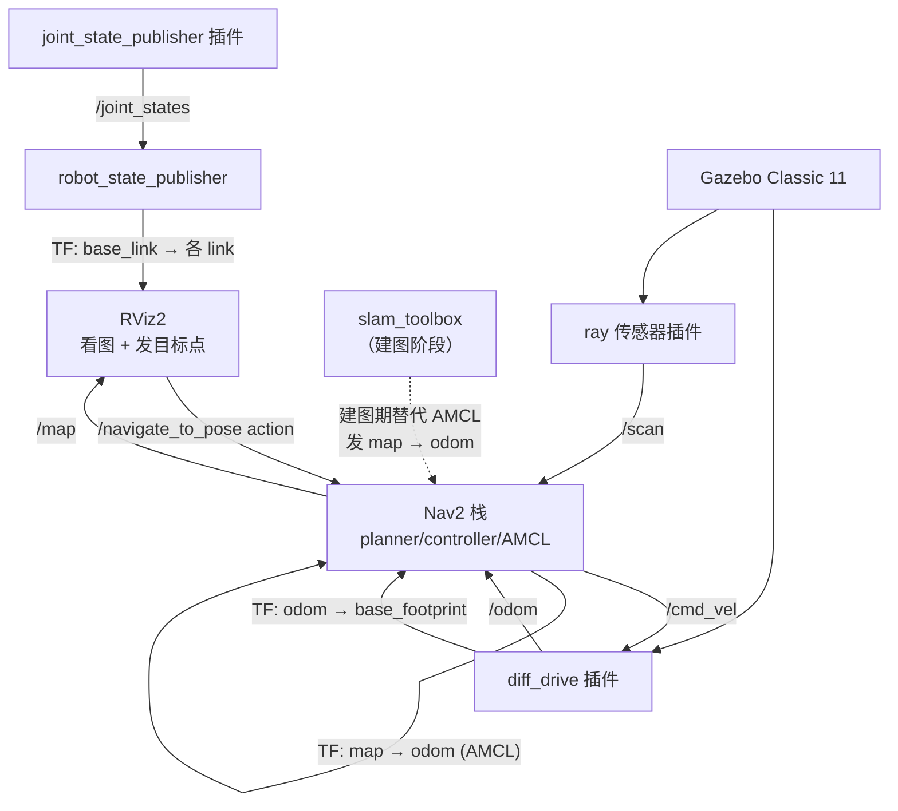

# 新开发者上手教程（navbot / ros_study）

> **写给谁**：刚拿到这个项目、有 ROS 基础但不了解本项目的人。
> **怎么用**：先读第 0 章（现状体检表），再按第 5 章把环境跑起来， 卡住了翻第 6 章。
> **文档基准**：基于 commit `03f2583`（分支 `main`）的源码实际状态编写。
> 所有"已完成/未完成"的判断都来自读源码，不是照抄 README。

---

## 0. 先看清楚：这个项目现在到哪一步了

**这一步最重要。** 本项目是"仿真已跑通、真机未落地"的状态，
如果你按字面理解文档里的每个名词，会误以为有大量功能其实不存在。

| 模块 | 状态 | 依据 |
|---|---|---|
| URDF/xacro 模型 | ✅ 可用 | `navbot.xacro` 结构完整，惯量宏齐全 |
| Gazebo 仿真 | ✅ 可用 | `navbot.gazebo.xacro` 三个插件齐备 |
| slam_toolbox 建图 | ✅ 可用 | `slam_mapping.launch.py` + 参数文件完整 |
| Nav2 导航 | ✅ 可用 | 包了一层官方 `bringup_launch.py`，参数已调 |
| 无头录 GIF | ✅ 可用 | `record_navigation.sh`（925 行，最成熟的脚本） |
| 环境一键重建 | ✅ 可用 | `setup_env.sh`（587 行，含大量踩坑注释） |
| **串口桥接（真机核心）** | ✅ **已实现** | `navbot_bridge/navbot_bridge/chassis_bridge.py`（448 行），`entry_points` 已注册 `chassis_bridge` |
| **STM32 固件** | ⚠️ **骨架，不可编译** | `navbot_chassis.c` 有 **25 个 TODO**，无 Makefile |

### 需要明确指出的几处"文档与现实的差异"

这几处不写清楚，新人会在第一步就撞墙：

1. **`navbot_bridge` 已在 2026-10-07 实现完毕。**
   `setup.py` 的 `entry_points.console_scripts` 已注册
   `'chassis_bridge = navbot_bridge.chassis_bridge:main'`，
   `package.xml` 的 `description` / `license` 已填（MIT）。
   → `ros2 run navbot_bridge chassis_bridge` 可以直接跑。
   （若你手上的是旧版本，先 `colcon build --packages-select navbot_bridge` 再试。）

2. **`无硬件自测/verify_e2e.sh` 现在应当全绿。**
   脚本第 4 步「检查 chassis_bridge 是否已写好」会找到节点，
   随后第 5/6 组（ROS2 话题层、TF 链、故障注入）都会真实执行。
   ★ 前提：你的机器有 `/dev/pts`（`socat` 能建虚拟串口对）。
   容器/沙箱里没有 pty 时，第 5/6 组会跳过 —— 这不是失败，
   用 `test_bridge_offline.py`（mock 串口）可以补上同样的判据。

3. **`firmware/navbot_chassis.c` 不能直接编译。**
   25 个 TODO 留着，且目录下**没有 Makefile**（文件头第 16 行提到"Linux 侧 arm-none-eabi-gcc + Makefile"，
   但那个 Makefile 并不存在，需要自己补）。

4. **`docs/Webots下载指南.md` 是游离文档。**
   该文件未被 git 跟踪（`git status` 显示 `??`），且全项目没有任何 Webots 相关代码或配置。
   → Webots 与本项目无关，可以忽略。

5. **`src/.vscode/settings.json` 里的路径是本机遗留**，
   硬编码了 Windows 绝对路径。该目录被 `.gitignore` 忽略，不会同步给其他人。

6. **底盘几何参数实际有 4 处需要保持一致**（README 第 34-38 行只提了 3 处）。
   完整清单见 §4.2，这是新手最容易踩的坑。

---

## 1. 项目简介与整体定位

### 1.1 一句话

一个基于 **ROS 2 Humble + Nav2 + slam_toolbox** 的两轮差速小车导航项目：
仿真阶段用 **Gazebo Classic 11** 模拟底盘，未来真机阶段换成 **STM32** 底盘，
**两侧复用同一份 URDF 模型**。

### 1.2 术语速查

| 术语 | 解释 |
|---|---|
| **ROS 2** | 机器人操作系统。本项目用的发行版是 **Humble**（对应 Ubuntu 22.04） |
| **Nav2** | ROS 2 官方的导航栈（Navigation2）。负责"给个目标点，车自己走过去"，包含路径规划、避障、控制器等节点 |
| **slam_toolbox** | 同时定位与建图（SLAM）的算法库。本项目用它替代 Nav2 默认的 AMCL 来"画地图" |
| **AMCL** | Adaptive Monte Carlo Localization，Nav2 默认的定位算法。已有地图后，用它估计车在地图中的位置 |
| **URDF** | Unified Robot Description Format，XML 格式的机器人模型描述语言，规定连杆（link）和关节（joint） |
| **xacro** | URDF 的宏扩展。用 Python 语法写循环/宏，避免重复粘贴 XML |
| **launch** | ROS 的启动文件。一次拉起多个节点并配置参数，避免手敲十几行命令 |
| **Gazebo** | 物理仿真器。本项目用 **Classic 11**（命令是 `gazebo`），**不是**新版 gz sim |
| **TF / 坐标变换** | 描述"车体、轮子、雷达、地图"之间的位置关系。TF 树断了，导航必然失败 |
| **差速驱动** | 通过左右两个轮子的速度差实现转向的车。只能前后走+转向，不能横移 |
| **socat** | Linux 工具，造一对虚拟串口，让不接硬件也能测串口链路 |

### 1.3 定位与边界

- **教学/练手项目**，不是生产级产品。大量注释在讲"为什么这样写"以及"踩过什么坑"。
- **导航部分不自研**：直接 include 官方 `nav2_bringup/launch/bringup_launch.py`，
  自己只提供参数文件和地图。这是刻意的取舍，见 §4.1。
- **自研部分集中在两处**：URDF 建模的惯量宏体系、串口协议设计。

---

## 2. 目录结构说明

### 2.1 顶层结构

```
ros_study/
├── src/                    ROS 2 工作空间（colcon 工作区）
├── firmware/               真机：STM32 固件与通信协议
├── 无硬件自测/              不接硬件也能验证串口协议的工具集
├── docs/                   全部文档（本文件也在此）
├── *.sh                    6 个运维/体检脚本 + 2 个 .bak 备份
└── README.md               项目主页
```

### 2.2 `src/` —— 三个 ROS 包（核心）

工作空间下有且只有三个包，依赖**单向、无循环**：

```
navbot_bringup  ──引用──>  navbot_description
       │
       └──（真机时才用到）──>  navbot_bridge
```

#### ① `navbot_description` —— 模型描述层

**只回答"车长什么样"，不放任何逻辑。**

| 文件 | 职责 | 接手后关注点 |
|---|---|---|
| `urdf/navbot.xacro` | **模型本体**。7 个 link、7 个 joint，定义 4 个惯量宏 | ★★★ 改几何尺寸、惯量都改这里 |
| `urdf/navbot.urdf.xacro` | **总装入口**。两行 include 拼装 | 真机/仿真的唯一分叉点 |
| `urdf/navbot.gazebo.xacro` | **仿真挂载层**。3 个 Gazebo 插件 | ★★ 差速驱动和雷达参数在这 |
| `launch/display_navbot.launch.py` | 只把模型丢进 RViz 看，不起仿真不起导航 | 调试模型的第一步 |
| `rviz/navbot_check.rviz` | 检查视图，Fixed Frame = `base_footprint` | |
| `CMakeLists.txt` | 把 `launch/urdf/rviz` 装到 `share/` 下 | 少了 install 段会报"文件未找到" |

**URDF 结构（`navbot.xacro`）：**

```
base_footprint  (根节点，贴地)
  └─ base_link   车体 0.30 × 0.24 × 0.06 m，1.2 kg
       ├─ left_wheel_link   圆柱 r=0.0325, l=0.026，0.15 kg，y = +0.08
       ├─ right_wheel_link  同上，y = -0.08
       ├─ front_caster_link 球 r=0.015，0.03 kg，x = +0.115
       ├─ back_caster_link  同上，x = -0.115
       └─ laser_link        雷达 r=0.035，0.10 kg，偏移 (0.04, 0, 0.05)
```

> **为什么有 4 个宏？** `box_inertia` / `cyl_inertia` / `sphere_inertia` /
> `wheel` / `caster` —— 手写惯量矩阵极易出错（漏项、符号错、量纲错），
> 宏把公式固化下来，改尺寸时惯量自动重算。详见 §4.3。

#### ② `navbot_bringup` —— 启动与配置层

**只回答"怎么把车跑起来"，不含模型、不含算法。**

| 文件 | 职责 | 接手后关注点 |
|---|---|---|
| `launch/display_navbot.launch.py`* | 看模型（在 description 包里） | |
| `launch/sim_navbot.launch.py` | **只起仿真**，不含 Nav2 | ★★ 验底盘通不通用它 |
| `launch/slam_mapping.launch.py` | 建图，包一层 slam_toolbox | |
| `launch/nav_bringup.launch.py` | **主 launch**，定位 + 导航 | ★★★ 导航调参入口 |
| `config/nav2_params.yaml` | Nav2 参数，15 个节点 | ★★★ 调参主战场 |
| `config/slam_toolbox_params.yaml` | slam_toolbox 参数 | ★★ 建图质量靠它 |
| `worlds/navbot_room.world` | Gazebo 世界：6×5 m 房间 + 障碍 | |
| `maps/navbot_room.yaml` | 地图元数据（配 `.pgm` 使用） | ★ resolution 必须与 slam 一致 |
| `maps/navbot_room.pgm` | 地图位图（11.8 KB） | 已被 git 跟踪 |
| `rviz/navbot_nav.rviz` | 导航视图，10 个显示项 | |
| `rviz/navbot_slam.rviz` | 建图视图，Fixed Frame = `map` | |

> **⚠️ 重要提醒：`maps/navbot_room.yaml` 是一份"带说明的地图文件"。**
> 它前半段是 20 多行教学注释（解释 `resolution` / `negate` / 阈值含义），
> 后半段才是真实参数。
> **一旦你重跑 `map_saver_cli`，这个文件会被整体覆盖、注释全部丢失。**
> 想保留注释就先备份。

#### ③ `navbot_bridge` —— 桥接层（真机）

```
navbot_bridge/
├── navbot_bridge/
│   └── chassis_bridge.py       448 行，节点主文件（含纯函数区）
├── config/bridge_params.yaml   真机串口参数（port / 轮距 / 轮半径 / PPR）
├── launch/bringup_real.launch.py  真机启动（桥 + Nav2）
├── resource/navbot_bridge      ament index 注册标记
├── setup.py                    entry_points 注册了 'chassis_bridge'
├── package.xml                 description/license 已填，declares rclpy 等
├── setup.cfg
└── test/                       3 个模板 lint 测试 + test_bridge_offline.py
```

**节点内部结构（读代码时按这个顺序看）：**

| 区块 | 内容 |
|---|---|
| 纯函数区（模块顶层） | `parse_odom_frame` / `cmdvel_to_wheel_mms` / `wheel_mms_to_cmdvel` —— 可脱离 ROS 单测 |
| `ChassisBridge.__init__` | 声明 4 个参数；建 3 个发布器 + 1 个订阅器；起读线程 |
| `_read_loop`（**独立线程**） | 阻塞读串口 → 解析 → 更新 `self._latest`，不发话题 |
| `_on_publish`（定时器 50 Hz） | 取最新值 → 算里程计积分 → 发 `/odom` + TF + `/joint_states` |
| `_on_cmd_vel`（spin 线程） | 差速逆解 → 组 V 帧 → 串口一发即走 |
| 三层异常 | 连接层重连 / 数据层静默计数 / 时效层超时停发 |

> ★ 三个设计决策的实证依据（为什么读串口必须独立线程、为什么用 round 不用 int、
> 为什么定时器发布）见 `docs/S20_复盘_chassis_bridge实现.md`，面试会问。

### 2.3 `firmware/` —— 真机侧

| 文件 | 职责 | 状态 |
|---|---|---|
| `navbot_protocol.md` | **通信协议 v1**。ASCII 明文，上行 11 字段 / 下行 4 字段 | ✅ 完整，11 KB |
| `navbot_chassis.c` | STM32F103C8T6底盘固件 | ⚠️ 骨架，25 个 TODO |

**协议速查（改代码前必看）：**

```
上行 STM32 → PC，50 Hz（20 ms/帧）
O,<seq>,<enc_l>,<enc_r>,<vel_l>,<vel_r>,<pwm_l>,<pwm_r>,<vbat_mv>,<tick_ms>,<temp_c100>\n

下行 PC → STM32，20 Hz（50 ms/帧，超时 500 ms 自动停车）
V,<seq>,<vel_l>,<vel_r>\n
```

| 字段 | 含义 | 为什么需要 |
|---|---|---|
| `seq` | 帧序号 | **丢帧检测的唯一手段**。没它无法区分"车没动"和"串口丢了 3 帧" |
| `tick_ms` | MCU 侧毫秒时间戳 | `header.stamp` 标的是"到达 PC 的时刻"而非"采样时刻"，差 1~2 ms，做里程计积分会产生系统误差 |
| `vel_l/r` | mm/s 整数 | MCU 上浮点格式化极慢，会吃掉实时循环的 CPU |
| `vbat_mv` | 电池电压 mV | 电压过低会导致轮子转不动，表现为"车不动"，很难联想到是电的问题 |

### 2.4 `无硬件自测/` —— 不接硬件也能验证

| 文件 | 行数 | 职责 |
|---|---|---|
| `fake_chassis.py` | ~370 | **假底盘**：在 PC 上冒充 STM32，内含完整差速运动学模拟 |
| `test_protocol.py` | 370 | 纯函数单测（协议解析 + 运动学换算），**不装 pytest 也能跑** |
| `verify_e2e.sh` | 531 | 端到端验证：假底盘 ↔ socat 虚拟串口 ↔ 桥接节点 ↔ ROS 话题 |

**`fake_chassis.py` 的四种故障注入**（用来验证桥接节点的异常处理）：

| 参数 | 模拟的故障 | 桥接层应有的行为 |
|---|---|---|
| `--stall-after N` | MCU 死机（发 N 帧后静默） | 检测到陈旧数据 → 暂停发 `/odom` |
| `--garbage-every N` | 串口乱码 | 静默计数坏帧，**不刷屏** |
| `--no-seq` | seq 恒为 0 | 识别出数据陈旧 |
| `--zero-drift MM` | 编码器零点漂移 | 让漂移可见，便于校准 |

**其内部 `DiffDriveSim` 类用真实运动学而非随机数**，
所以可以这样验证里程计：走 1 米看 `x ≈ 1.0`（验单位换算），原地转 360° 看 `yaw ≈ 6.283`（验轮距）。
默认参数：`wheel_sep=0.16`、`wheel_radius=0.0325`、`encoder_ppr=2112.0`、
电机一阶延迟时间常数 `tau=0.1s`。

### 2.5 根目录脚本

| 脚本 | 行数 | 用途 |
|---|---|---|
| `setup_env.sh` | 587 | 环境一键重建（配源 → 装包 → 改配置 → 编译），15~25 分钟，幂等 |
| `check_env.sh` | 415 | 3 秒体检，只读。`--fix` 自动补|
| `check_sim.sh` | 249 | 仿真层**四道门**体检 |
| `record_navigation.sh` | 925 | 无头环境录导航 GIF |
| `diag_ros_apt_key.sh` | 202 | apt 源与 GPG 密钥专项诊断 |
| `audit_scripts.sh` | 137 | 脚本自审 |

> `record_navigation.sh.v1.bak` / `setup_env.sh.v1.bak` 是旧版留档，
> `.gitignore` 已忽略 `*.bak`，不会同步。

---

## 3. 核心流程与模块间的调用关系

### 3.1 整体数据流（导航阶段）



### 3.2 阶段一：看模型（最快的一环）

```bash
ros2 launch navbot_description display_navbot.launch.py
```

**数据流转：**

```
navbot.xacro（模型本体）
      + navbot.gazebo.xacro（仿真插件）        ← xacro 展开
      ↓
navbot.urdf.xacro  --xacro 命令-->  URDF 字符串
      ↓ 存入 robot_description 参数
robot_state_publisher  --发布-->  /robot_description 话题
      ↓                                    ↓
  广播 /tf（base_link→各 link）RViz 订阅并渲染
```

> **注意这个阶段没有雷达数据。** Gazebo 插件在 Gazebo 进程里，
> 没起 Gazebo 就没有 `/scan`，RViz 的 LaserScan 项是空的。这是正常的。

### 3.3 阶段二：让车动起来（验底盘）

**需要两个终端同时运行。**

```bash
# 终端 1
ros2 launch navbot_bringup sim_navbot.launch.py
# 终端 2
ros2 run teleop_twist_keyboard teleop_twist_keyboard
```

**数据流转（这一环是整个项目的地基）：**

```
① xacro 展开 navbot.urdf.xacro
        ↓
② robot_state_publisher 持有 robot_description
        ↓ 发布 /robot_description
③ spawn_entity.py 订阅该话题，3 秒后把车塞进 Gazebo 世界
        ↓
④ diff_drive 插件（<gazebo> 标签加载 .so 文件）开始工作
        ↓
   /cmd_vel ──→ [差速逆解] ──→ 左右轮目标速度 ──→ Gazebo 物理引擎
                                                          ↓
   /odom←────── [正运动学积分] ←── 轮子实际转速 ────────┘
        ↓
   TF: odom → base_footprint←────┘
        ↓
   ray 传感器插件 ──→ /scan（约 10 Hz）
```

**验证命令与期望值：**

| 命令 | 期望 | 不达标的含义 |
|---|---|---|
| `ros2 topic hz /scan` | 约 10 Hz | 雷达插件没加载（多半是`gpu_ray` 没换成 `ray`） |
| `ros2 topic hz /odom` | 约 50 Hz | diff_drive 插件 `update_rate` 是 50 |
| `ros2 run tf2_ros tf2_echo odom base_footprint` | 持续输出 | TF 树断了，Nav2 一定失败 |

> `ros2 run tf2_tools tf2_echo` 会报"No executable found"——
> `tf2_tools` 里只有 `view_frames`。用 `tf2_ros`。

**为什么把仿真和导航拆成两个 launch？**
`sim_navbot` 的文件头（第 3-4 行）写明了理由：
"把「底盘能不能动」和「Nav2 能不能规划」分开验，一起起的话出错时分不清是底盘没通还是导航没配。"

### 3.4 阶段三：建图

```bash
# 终端 1（沿用阶段二，不要重启）
ros2 launch navbot_bringup sim_navbot.launch.py
# 终端 2
ros2 launch navbot_bringup slam_mapping.launch.py use_sim_time:=true
# 终端 3
ros2 run teleop_twist_keyboard teleop_twist_keyboard
```

**数据流转：**

```
/scan（10 Hz）+ /odom（50 Hz）
        ↓
slam_toolbox（online_async_launch.py）
   ·扫描匹配 → 把每帧激光对齐到已有地图
        ↓
   /map（约 0.2 Hz，即 5 秒一帧）
        ↓
map_saver_cli ──→ navbot_room.pgm + navbot_room.yaml
        ↓
人工把两个文件拷到 src/navbot_bringup/maps/
```

**存图前必须确认：**

```bash
ros2 topic hz /map         # 必须有帧，约 0.2 Hz
ros2 node list | grep slam_toolbox   # slam_toolbox 还活着
```

> `map_saver_cli` 报 `Failed to save the map: Map not received`
> 的原因就是 slam_toolbox 已退出或`/map` 还没发过第一帧。**不要在它死后存图。**

遥控走图时速度要慢（0.1 m/s 左右），转太快会建糊。

### 3.5 阶段四：定位 + 导航（主 launch）

```bash
# 终端 1：仿真仍在跑
ros2 launch navbot_bringup sim_navbot.launch.py
# 终端 2
ros2 launch navbot_bringup nav_bringup.launch.py use_sim_time:=true
```

**数据流转（完整闭环）：**

```
【定位链】
map → odom←─ AMCL（对比 /scan 与 /map 算位姿）
                            ↑ /scan, /map, /odom
【规划链】
RViz "Nav2 Goal" → /navigate_to_pose action
                            ↓
                  planner_server（全局路径，用 global_costmap）
                            ↓
                  controller_server（局部路径，用 local_costmap）
                            ↓
                     /cmd_vel → diff_drive → 车动
【代价地图】
/scan → obstacle_layer → 与 static_layer（静态地图）叠加
                ↓
        inflation_layer（膨胀层：给障碍物"加粗"，
                        让路径离墙留出安全余量）
```

**首次使用必须先给初始位姿**：

1. RViz 工具栏点 **2D Pose Estimate**，在地图上按住拖动 → 给车一个大致位置和朝向
2. 等粒子云收敛（车体附近聚成一团）
3. 再点 **Nav2 Goal** 发目标点

不依赖 RViz 的命令行方式：

```bash
ros2 action send_goal /navigate_to_pose nav2_msgs/action/NavigateToPose \
  "{pose: {header: {frame_id: map}, pose: {position: {x: 1.5, y: 1.0, z: 0.0}, orientation: {w: 1.0}}}}"
```

> **⚠️ 建图与导航互斥。** 两者都会发布 `map → odom` 变换，同时跑就是两个节点抢同一个 TF，
> 表现为 TF 抖动、位置乱跳。所以 `nav_bringup.launch.py` 里刻意**没有** include `slam_mapping`。

### 3.6 真机链路（已实现）

```
/cmd_vel (nav_msgs/Twist)
        ↓  _on_cmd_vel()  →  cmdvel_to_wheel_mms()
   差速逆解 v_l = v - ω·L/2,  v_r = v + ω·L/2       L = 0.16 m
        ↓  转 mm/s 整数，round 而非截断
   "V,<seq>,<vel_l>,<vel_r>\n"  ← ASCII 明文
        ↓  USB 转串口，115200 8N1
   STM32 底盘 → PID → PWM → 电机
        ↓
   编码器计数 → 整帧上行
        ↓  "O,<seq>,<enc_l>,...,\n"  50 Hz
   _read_loop()  →  parse_odom_frame()
        ↓
   _on_publish()（定时器 50 Hz）
        ↓
   /odom + TF(odom→base_footprint) + /joint_states
```

**不用硬件也能走通整条链**：`fake_chassis.py` 冒充 STM32，按下行 V 帧驱动
一个一阶延迟的差速模型，再按上行 O 帧格式吐回来。

```bash
# 方式一：端到端（需 socat，即有 /dev/pts）
cd 无硬件自测 && ./verify_e2e.sh

# 方式二：无 pty 环境，mock 串口直接驱动桥
python3 src/navbot_bridge/test/test_bridge_offline.py

# 只想看数据长什么样（不占串口）
python3 无硬件自测/fake_chassis.py --dry-run
```

四种故障注入（`--garbage-every` / `--stall-after` / `--no-seq` / `--zero-drift`）
可验证桥的韧性——乱码注入期间桥应保持发布且日志极短。

---

## 4. 关键概念与设计取舍

### 4.1 取舍一：导航不自研，包一层官方 launch

`nav_bringup.launch.py` 全文只做一件事——include 官方的
`nav2_bringup/launch/bringup_launch.py`，把自己的地图和参数文件喂进去。

**为什么不自己写？**
- Nav2 的行为规划器、行为树、生命周期管理机制复杂，重写没有收益。
- 自研部分越少，能深入讲解的部分越多——这个项目的价值在于讲清楚，不是造轮子。

**代价**：必须理解官方 launch 的参数语义（比如不传 `slam` 参数会自动走 AMCL 分支，
见 `nav_bringup.launch.py:60`）。

### 4.2 取舍二：参数一致性用"注释约束"维护（本项目最大的坑）

**底盘几何参数实际出现在 4 个地方**，必须完全一致：

| # | 文件 | 参数 | 当前值 |
|---|---|---|---|
| 1 | `navbot_description/urdf/navbot.xacro:66` | 轮距（`side * 0.16 / 2`） | 0.16 m |
| 2 | `navbot.gazebo.xacro:79-80` | `wheel_separation` / `wheel_diameter` | 0.16 / 0.065 m |
| 3 | `firmware/navbot_chassis.c:62,65` | `WHEEL_SEPARATION_M` / `WHEEL_RADIUS_M` | 0.16 / 0.0325 m |
| 4 | `无硬件自测/fake_chassis.py:358-359` | `--wheel-sep` / `--wheel-radius` | 0.16 / 0.0325 m |

另有一处**间接相关**：

| 5 | `navbot_bringup/config/nav2_params.yaml:318,377` | `robot_radius` | 0.20 m |

> **为什么 `robot_radius = 0.20` 要大于车体半对角？**
> 车体是 0.30 × 0.24 m，半对角线= √(0.15² + 0.12²) ≈ 0.192 m。
> 代价地图把车简化成一个圆，这个圆必须**包住整个车**，
> 否则路径规划会"切进车体"。0.20 是取整后的安全余量。

**不一致的后果**：里程计出现**系统性偏差**——车实际走 1 m，`/odom` 报 0.9 m。
这类错误不会报错，只会让定位慢慢漂移，排查成本极高。

### 4.3 取舍三：惯量用宏，不手写

`navbot.xacro` 定义了三个惯量宏：

```xml
<!-- 长方体 -->
ixx = m(y² + z²)/12    iyy = m(x² + z²)/12    izz = m(x² + y²)/12
<!-- 圆柱（轴沿 Z） -->
ixx = iyy = m(3r² + h²)/12    izz = mr²/2
<!-- 球 -->
ixx = iyy = izz = 2mr²/5
```

**为什么不手写**：惯量矩阵有 6 个独立分量，漏填、符号错、量纲错都不会报错，
只会让仿真行为失真。用宏之后，改尺寸时惯量自动重算，从根上消除这类错误。

> **一个易错点**：URDF 的惯量坐标系原点在**质心**。
> 若几何体的几何中心不等于质心，需要在 `<inertial><origin>` 里补偿。
> 本项目所有部件都是均匀对称的，质心即几何中心，所以全填 `0 0 0`。

### 4.4 取舍四：仿真与真机共用模型，靠"include 分叉"

```xml
<!-- navbot.urdf.xacro -->
<include filename=".../navbot.xacro"/>          <!-- 模型本体：仿真真机共用，一字不改 -->
<include filename=".../navbot.gazebo.xacro"/>  <!-- 仿真挂载：真机时注释掉这一行 -->
```

**理由**（`navbot.gazebo.xacro` 文件头第 6-11 行）：
> URDF 是"描述机器人长什么样"，Gazebo 插件是"描述在仿真里怎么动"。
> 真机上这两个东西完全不同源：仿真里 `<plugin>` 由 Gazebo 加载（.so 文件），
> 真机上由自己的 driver 节点发 `/odom` + `/joint_states`。
> 所以物理上就该分开写。

**收益**：改模型（如加机械臂）时，仿真和真机同时生效，不会漏改一边。

### 4.5 取舍五：ASCII 明文协议

|方案 | 优点 | 缺点 | 本项目选择 |
|---|---|---|---|
| **ASCII** | 串口助手直接看、直接敲，调试成本接近零 | 带宽利用率低 | ✅ |
| 二进制 | 省带宽、有 CRC | 调试时看不到人话 | ❌（留待多电机/CAN 阶段） |

**带宽算账**：50 Hz × 40 字节 ≈ 2 KB/s，115200 baud = 11.5 KB/s，**占用不到 20%**。
ASCII 完全够用。

### 4.6 取舍六：三层异常处理（PC 侧收坏数据）

继承自作者前一个项目（sensor_bridge）的经验，分三层：

| 层级 | 异常 | 处理方式 |
|---|---|---|
| 连接层 | 串口打不开/ 拔线 | 重连，不崩节点；warn 日志节流（5 秒最多一条） |
| 数据层 | 乱码/ 半包 / 字段数不对 | 静默计数，**绝不刷屏** |
| 时效层 | seq 长时间不增长 | **暂停发布 `/odom`** + 只警告一次 |

> **为什么"数据陈旧"必须暂停发布而不是继续发旧值？**
> Nav2 的代价地图和 AMCL 会把旧位姿当真值，结果是"车明明停了，代价地图还在滚动"，
> 进而定位漂移、规划错乱——**现象非常隐蔽**，极难定位。

### 4.7 取舍七：安全兜底 —— 失联 500 ms 自动停车

协议文档第四章（"必做，不做会撞墙"）：

```c
if (now_tick - last_cmd_tick > 500)   /* 500 ms 没新指令 */
    set_motor_speed(0, 0);            /* 立即停车 */
```

**为什么是 500 ms？**
- PC 侧 20 Hz 发指令，500 ms =丢掉 10 条，足以确定"不是偶发丢包，是对端真挂了"
- 再大则危险：0.2 m/s × 1 s = 20 cm，够撞到东西
- 再小会误触发：串口偶然卡一下就停车，很难开

> **这是真机项目和仿真项目最重要的区别之一。**
> WiFi 断了 / Python 节点崩了 / 手滑 Ctrl+C 了，车都会自己停下来。

### 4.8 取舍八：`use_composition=False`（硬编码）

`nav_bringup.launch.py:73` 强制关闭 Nav2 节点合成，注释说明了原因：

> 必须 False：`use_composition=True` 时 Nav2 节点合进一个容器，
> 生命周期管理会卡死（planner_server 的 get 无响应），
> 表现为 autostart 失效、手动激活卡住。

---

## 5. 安装、配置与本地运行步骤

### 5.1 环境要求

| 项 | 要求 | 说明 |
|---|---|---|
| 操作系统 | **Ubuntu 22.04 (jammy)** | ROS 2 Humble 的官方目标平台 |
| ROS | **ROS 2 Humble Desktop** | 不是 Foxy，也不是 Jazzy |
| 仿真器 | **Gazebo Classic 11**（包名 `gazebo`） | ⚠️ **不要装 `ros-humble-ros-gz`** |
| Python | `/usr/bin/python3` 必须是 **3.10** | 魔搭容器默认是 3.11，ROS Humble 只支持 3.8~3.10 |
| 硬件（真机） | STM32F103C8T6 + USB 转串口 | 仿真阶段不需要 |
| 可选 | `socat` | 仅无硬件自测需要 |
| 磁盘 | `/mnt/workspace` 需为**持久存储** | 环境层会丢，源码不能丢 |

> **项目原本面向"魔搭免费实例"**（`/mnt/workspace` 是 NAS）。
> 但它不依赖魔搭专有功能，任何 Ubuntu 22.04 + Humble 环境都可用，
> 只需保证工作空间路径与脚本里的`WORKDIR="/mnt/workspace"` 一致，
> 或自行修改 `check_env.sh:26`。

### 5.2 安装（一条命令）

```bash
cd /mnt/workspace       # 你的工作空间根目录
bash setup_env.sh
```

耗时 15~25 分钟。脚本做了这些事（幂等，可重复跑）：

1. 配 ROS 2 apt 源（国内镜像，按中科大 → 清华 → 阿里云 → 官方 顺序兜底）
2. 装 ROS 2 GPG 密钥（强制 `chmod 644`）
3. 装全部依赖包（约 **211** 个，按需安装，不是 desktop 全套）
4. **修正 `gpu_ray` → `ray`**（无头环境必需，见 §6.2）
5. 清理旧 build 缓存（内含上一实例的错误 Python 路径）
6. 编译工作空间
7. 写环境变量到 `~/.ros_env` 并在 `~/.bashrc` 第一行 source 它

**装完的判据**：`ros2` 命令可用（`ros-humble-ros2cli` 是个隐形依赖，容易漏装，
漏了不报错、编译也过，只是敲 `ros2` 提示未找到命令）。

### 5.3 体检

```bash
bash check_env.sh          # 只读，3 秒出结论
bash check_env.sh --fix    # 自动补装缺失项
```

退出码 `0` = 正常，`1` = 有问题（报告会直接告诉你该敲哪条命令）。

### 5.4 每个新终端都要做的动作

环境变量写在 `~/.ros_env` 里，**每个新终端都要 source**：

```bash
source ~/.ros_env
```

> 为什么要单独抽一个文件？魔搭容器的 Terminal 读 `~/.bashrc` 时会在开头的
> "非交互保护"处提前 return，追加到文件末尾的配置不生效。
> 抽到独立文件再塞到 bashrc 第一行才能保证生效。
>
> `~/.ros_env` 里除了 source `/opt/ros/humble/setup.bash`，
> 还 source 了工作空间的 `install/setup.bash`——否则会出现
> "ros2 命令有了，但 ros2 launch 找不到 navbot_*"。

### 5.5 四阶段运行（完整流程）

```bash
# ── 阶段 ① 看模型（不需要 Gazebo，最快验证 URDF）
source ~/.ros_env
ros2 launch navbot_description display_navbot.launch.py
# 期望：RViz 出现机器人模型，TF 树 base_footprint→base_link→laser_link 完整

# ── 阶段 ② 让车动起来（另开终端）
ros2 launch navbot_bringup sim_navbot.launch.py
# 无头环境加 gui:=false
#   ros2 launch navbot_bringup sim_navbot.launch.py gui:=false
ros2 run teleop_twist_keyboard teleop_twist_keyboard
# 验证
ros2 topic hz /scan      # 约 10 Hz
ros2 topic hz /odom      # 约 50 Hz
# /odom 的 frame_id 应为 odom，child_frame_id 应为 base_footprint

# ── 阶段 ③ 建图（终端 1 的仿真保持运行，不要重启）
ros2 launch navbot_bringup slam_mapping.launch.py use_sim_time:=true
ros2 run teleop_twist_keyboard teleop_twist_keyboard    # 慢速走一圈，覆盖房间
ros2 topic hz /map# 确认约 0.2 Hz
ros2 run nav2_map_server map_saver_cli -f navbot_room
# 把生成的 .pgm / .yaml 拷到 src/navbot_bringup/maps/

# ── 阶段 ④ 导航
ros2 launch navbot_bringup nav_bringup.launch.py use_sim_time:=true
# RViz：先 2D Pose Estimate，再 Nav2 Goal
```

### 5.6 launch 参数速查

| launch | 参数 | 默认 | 说明 |
|---|---|---|---|
| `sim_navbot` | `gui` | `true` | 无头环境设 `false` |
| | `use_sim_time` | `true` | 仿真必须 true |
| | `world` | `navbot_room.world` | |
| `slam_mapping` | `use_sim_time` | `true` | |
| | `use_rviz` | `true` | |
| | `slam_params_file` | `slam_toolbox_params.yaml` | |
| `nav_bringup` | `map` | `maps/navbot_room.yaml` | |
| | `params_file` | `config/nav2_params.yaml` | |
| | `use_sim_time` | `true` | **真机改 `false`** |
| | `use_rviz` | `true` | |
| | `autostart` | `true` | 生命周期节点自动激活；调试可设 `false` 逐个手动激活 |
| `display_navbot` | `use_sim_time` | `true` | |
| | `use_rviz` | `true` | |

### 5.7 调参要点

**`config/nav2_params.yaml`（15 个节点）**

| 项 | 值 | 说明 |
|---|---|---|
| `robot_radius` | 0.20 | 代价地图机器人圆半径，必须包住车体半对角（≈0.192） |
| `max_vel_x` | 0.22 | 差速车不倒车，`min_vel_x` 为 0 |
| `max_vel_theta` | 1.0 | 原地旋转角速度 |
| `xy_goal_tolerance` | 0.15 | 位置容差 |
| `scan_topic` | `scan` | **无 `/` 前缀**，适配 Gazebo 的相对话题名 |
| `robot_model_type` | `nav2_amcl::DifferentialMotionModel` | 差速车专用运动模型 |

**`config/slam_toolbox_params.yaml`**（单个 `slam_toolbox:` 根键）

| 项 | 值 | 说明 |
|---|---|---|
| `resolution` | 0.05 | **必须与地图 yaml 的 `resolution` 一致**，否则地图被缩放、路径撞墙 |
| `odom_frame` / `base_frame` | `odom` / `base_footprint` | |
| `enable_interactive_mode` | `true` | 允许在 RViz 里手动拉回环 |

**`maps/navbot_room.yaml`**

| 项 | 值 | 说明 |
|---|---|---|
| `resolution` | 0.05 | 必须 = slam 的 resolution |
| `origin` | `[-3.5, -3.0, 0.0]` | 由 map_saver 自动填，**不要手改** |
| `negate` | 0 | ⚠️ 搞反了 Nav2 会把空地当障碍，一步都走不了 |

### 5.8 无硬件验证（不需要 STM32）

```bash
apt install socat

# 1. 看数据长什么样（不占串口）
python3 无硬件自测/fake_chassis.py --dry-run

# 2. 协议与运动学单测（不需要 pytest）
python3 无硬件自测/test_protocol.py

# 3. 造一对虚拟串口
python3 无硬件自测/fake_chassis.py --make-socat   # 占 /tmp/ttyV0
# 另开终端：桥接节点应占 /tmp/ttyV1
ros2 run navbot_bridge chassis_bridge --ros-args -p port:=/tmp/ttyV1

# 4. 端到端验证
bash 无硬件自测/verify_e2e.sh   # 10 项判据应全绿（需 /dev/pts；无 pty 用 mock 版）
```

---

## 6. 常见问题与排查思路

### 6.1 排查总原则：看缺的是哪个 TF 帧，就知道查哪一层

这张表来自 `record_navigation.sh` 第 42-47 行，是最快的定位手段：

| 缺失的 TF 帧 | 问题在哪一层 | 查什么 |
|---|---|---|
| `map` | **Nav2 层** | AMCL 没发 `map→odom`，多半是没给初始位姿 |
| `odom` / `base_footprint` | **仿真层 / 硬件层** | diff_drive 插件，或真机串口桥 |
| `laser_link` | **模型层** | robot_state_publisher + URDF |

> **重要认知：TF 帧比话题更能说明问题。**
> Nav2 要的是 TF 变换，不只是话题数据。`check_sim.sh` 的四道门里，
> 专门有一道是查 TF 而不是查话题，原因就在这里。

### 6.2 环境层问题

| 现象 | 根因 | 处理 |
|---|---|---|
| `ros2: 未找到命令` |漏装 `ros-humble-ros2cli`（隐形依赖，不报错最难查） | `bash check_env.sh --fix` |
| `Could not find "ament_lint_auto"` | `colcon build` 默认 `BUILD_TESTING=ON`，会执行 `find_package(ament_lint_auto REQUIRED)` | `bash setup_env.sh`（会补装） |
| `NO_PUBKEY F42ED6FBAB17C654` | 密钥权限是 600 时 apt 读不到（apt 以 `_apt` 用户执行 `gpgv`） | `bash diag_ros_apt_key.sh` → `chmod 644` |
| rosdep init 卡住 | 它要访问 `raw.githubusercontent.com`，国内不通 | `setup_env.sh` 已绕开（直接写镜像版清单） |
| `/usr/bin/python3` 不是 3.10 | 魔搭容器默认 3.11，Humble 只支持 3.8~3.10 | `setup_env.sh` 会校验并停下说明 |
| 环境变量不生效 | 容器 Terminal 在 bashrc "非交互保护"处提前 return | `source ~/.ros_env` 显式加载 |
| `ros2 launch` 找不到 `navbot_*` | 只 source 了 ROS 没 source 工作空间 | 检查 `~/.ros_env` 里是否 source 了 `install/setup.bash` |

> **关于 NO_PUBKEY 的排查陷阱**：不要用 `gpg --show-keys` 自检。
> 那是**以 root 身份**读的，600 权限也能读，会永远显示"校验通过"，
> 而 apt 仍然失败。判断标准只有一个：**other 位可读（644）**。

### 6.3 仿真层问题

| 现象 | 根因 | 处理 |
|---|---|---|
| **`/scan` 空 / 话题不出现** | `gpu_ray` 依赖 GPU 渲染，无头环境被禁（render path NONE） | `setup_env.sh` 会自动把 xacro 里 `gpu_ray` 改成 `ray`；桌面环境可换回 `gpu_ray` 更快 |
| **`Waiting for entity xml on /robot_description` 后一直挂** | `-topic` 与 `-entity` 没配对，或话题名写错 | 检查 `sim_navbot.launch.py:106-108`，两者必须成对出现 |
| **`Service /spawn_entity unavailable`** | Gazebo 起得慢，spawn 太早 | 已有 `TimerAction(period=3.0)` 延迟；残留 gzserver 未清也会导致，清理后重试 |
| **车原地打滑 / 轮子转但车不动** | URDF 轮子默认摩擦力偏小 | `navbot.gazebo.xacro:41-51` 已设 `mu1/mu2 = 0.8`，改模型时别丢 |
| **Gazebo 日志有 `Joint [...] not found`，车纹丝不动** | `<left_joint>`/`<right_joint>` 与 URDF 里的 joint 名不一致 | 应为 `left_wheel_joint` / `right_wheel_joint` |
| **`gzserver` 活着但 `/spawn_entity` 不回应** | 上次残留的 gzserver 没清干净 | `bash check_sim.sh`（开头会清理），或 `bash record_navigation.sh --clean-only` |
| **RViz 里轮子不转** |缺 `joint_state_publisher` 插件 | `navbot.gazebo.xacro:108-117` 提供，30 Hz |
| **里程计系统性偏差** | 轮距/轮径在 4 处不一致 | 见 §4.2 的一致性清单 |

> **Gazebo 版本坑**：Humble 对应 **Gazebo Classic 11**，包名 `gazebo`。
> 不要装 `ros-humble-ros-gz`（那是新版桥接包），
> URDF 里的 `<gazebo>` 标签会找不到插件——两版的 launch 写法完全不同。

### 6.4 导航层问题

| 现象 | 根因 | 处理 |
|---|---|---|
| **`Invalid frame ID "map"` 一直刷** | `set_initial_pose: false` 且没给初始位姿 → 没有节点广播 `map→odom` | 先给初值。**顺序必须是：amcl 就绪 → 发初值（重发到 map→odom 出现）→ 再等 planner_server** |
| **TF 抖动、位置乱跳** | 建图与导航同时跑，两个节点抢 `map→odom` | 停掉其中一个。二者互斥 |
| **RViz 地图像"负片"，一步都走不了** | `negate` 搞反了（1了） | 改回 `0` |
| **路径撞墙 / 地图被缩放** | 地图 `resolution`(0.05) ≠ slam 的 `resolution` | 两者改为一致 |
| **代价地图"擦不掉"已走过的障碍** |雷达量程 < `raytrace_max_range` | 雷达 max 已设 12.0，通常够；检查 Nav2 侧参数 |
| **autostart 失效、手动激活卡住** | `use_composition=True` 时生命周期管理卡死 | 已在 `nav_bringup.launch.py:73` 硬编码为 False |
| **`Failed to send goal response ... client will not receive response`** | 不代表目标没被接受，服务端可能已在执行 | 安全，可重发（Nav2 会抢占上一个目标） |
| **`ros2 service call` 永久阻塞** | ROS 2 CLI 无内建超时 | 所有 `ros2` 调用套硬超时；`record_navigation.sh` 里封装了 `rcli()`/`has_tf()` |
| **日志长时间为空** | Python stdout块缓冲 | `stdbuf -oL -eL` + `PYTHONUNBUFFERED=1` |
| **`lifecycle_manager` 查不到状态** | 它**不是** lifecycle 节点，没有 `get_state` 服务 | 查它是误报 |

### 6.5 一个已知遗留问题：地图与世界坐标偏移

`record_navigation.sh:33-40` 记录了一次离线比对的结果：

```
map = world + (-0.5, -0.5)
```

- 地图里那根 2.6 m 隔断墙，world 里中心是 (-0.5, +0.5)，地图上量出来是 x −1.25~+0.35 / y −0.10~+0.10
- 三面墙也对得上同一组偏移（west −3.45 vs −2.95、east +2.40 vs +2.95）
- **Gazebo 出生点 (0,0) 在地图上是 (−0.5, −0.5)**
- 而 `map(0,0)`恰好落在隔断墙上（占用格）

**症状**：告诉 AMCL「你在 map(0,0)」会让初始位姿偏 0.71 m，
AMCL 只能靠激光硬拉回来，表现为**开局一次 recovery、第一段规划特别慢**。

**验证**：
```bash
ros2 topic echo /amcl_pose --once    # x,y 若是 -0.5/-0.5 说明正常
```

**彻底修法**：把 `maps/navbot_room.yaml` 的 `origin` 从 `[-3.5, -3.0]` 调到约 `[-2.98, -2.48]`，
让地图以车的出生点为中心，改完就回到 0/0。
（但注意：**重跑 `map_saver_cli` 会覆盖这个文件**，届时需要重新调整。）

因此 `record_navigation.sh` 的初始位姿默认用 `INIT_X=-0.50` / `INIT_Y=-0.50`。

### 6.6 脚本自身的问题

| 现象 | 根因 |
|---|---|
| `bash: $'\r': command not found` | 文件被 Windows CRLF 污染。`.gitattributes` 已锁 `eol=lf`，**别删** |
| `/opt/ros/humble/setup.bash: AMENT_TRACE_SETUP_FILES: 未绑定的变量` | `set -u` 下 source ROS 的 setup.bash 会中止。解法：source 期间 `set +u` |
| 单独 source 没问题，写进脚本就挂 | 同上 |
| `if cmd \| tee log; then` 永远为真 | 管道退出码是 `tee` 的（恒 0）。需要 `set -o pipefail` |
| `echo"xxx"` 运行时才炸 | bash 里语法合法（被当成一个命令名），`bash -n` 查不出 |

**最后两类错误`bash -n` 查不出来**，改完 shell 脚本跑一次：

```bash
bash audit_scripts.sh     # 专抓"语法合法、行为错误"的两类问题
```

---

## 7. 快速上手路径建议

**如果你要接手这个项目，建议按这个顺序推进：**

1. **先跑通阶段 ①**（`display_navbot`）—— 5分钟，确认环境和 URDF 没问题
2. **再跑阶段 ②**（`sim_navbot` + `teleop`）—— 确认底盘、雷达、TF 都通
3. **然后直接跳到阶段 ④**（`nav_bringup`）—— 用仓库里现成的地图，不必重新建图
4. **需要调参时再读** `docs/A5_知识概念全解.md`
5. **要动模型时读** `docs/A3_URDF建模概念清单.md`
6. **要碰真机时读** `firmware/navbot_protocol.md`（改协议前必看）

**第一个应该动手的任务**：实现 `navbot_bridge` 的两个节点。
`verify_e2e.sh` 就是你的验收判据——它现在停在"找不到 `chassis_bridge`"，
等你写完、注册进 `setup.py` 的 `entry_points`，它就会往下跑完整个链路验证。

### 需要重点关注的文件（按改动频率排序）

| 频率 | 文件 | 改什么 |
|---|---|---|
| 高 | `config/nav2_params.yaml` | 导航调参，15 个节点 |
| 高 | `navbot.xacro` | 车体尺寸、惯量、雷达位置 |
| 中 | `navbot.gazebo.xacro` | 差速驱动参数、雷达量程与噪声 |
| 中 | `slam_toolbox_params.yaml` | 建图质量 |
| 中 | `worlds/navbot_room.world` | 仿真场景布局 |
| 低 | `navbot.urdf.xacro` | 只在真机/仿真分叉时改 |
| 低 | `*.sh` | 环境与体检；改完必跑 `audit_scripts.sh` |
| 低 | `package.xml` / `CMakeLists.txt` | 加依赖、加目录 |

---

## 附录 A：相关文档索引

| 文档 | 内容 | 什么时候读 |
|---|---|---|
| `README.md` | 项目主页、速查表 | 日常最常用 |
| `docs/P3_ROS2自主导航移动机器人_保姆级项目文档.md` | 主线教程，阶段 A→D（90 KB，最详细） | 系统学习 |
| **本文件** | 新开发者接手教程 | 第一次接手 |
| `docs/A4_三包架构说明.md` | 三包架构拆解 | 理解"改哪里" |
| `docs/A3_URDF建模概念清单.md` | 建模概念与惯量宏 | 改模型前 |
| `docs/A3_URDF建模模板.md` | URDF 模板 | 从零建新模型 |
| `docs/A5_知识概念全解.md` | 概念答疑（29 KB） | 遇到不懂的名词 |
| `docs/00_环境一键安装文档.md` | 环境配置与踩坑（25 KB） | 环境出问题 |
| `firmware/navbot_protocol.md` | 通信协议 v1 | 碰真机前 |
| `docs/G1_Git推送到 GitHub详细步骤.md` | 推送步骤 | 需要同步代码时 |

## 附录 B：术语索引

| 术语 | 一句话解释 | 出现章节 |
|---|---|---|
| **colcon** | ROS 2 的构建工具，负责编译工作空间下所有包 | §5.2 |
| **ament** | ROS 2 的构建系统框架，`ament_cmake`（C++包）/ `ament_python`（Python 包） | §2.2 |
| **生命周期节点** | Nav2 的节点需手动"激活"才工作，`autostart` 控制是否自动激活 | §5.6 |
| **代价地图** | 把环境转成"能不能走"的网格，含障碍层和膨胀层 | §3.5 |
| **膨胀层** | 给障碍物加粗，让路径自动离墙留安全距离 | §3.5 |
| **膨胀半径 / 代价** | 离障碍越近代价越高，planner 会偏好远路 | §3.5 |
| **静态层** | 由已保存地图提供的固定障碍 | §3.5 |
| **RViz** | ROS 的可视化工具，看 TF、地图、激光、路径 | §3.5 |
| **Fixed Frame** | RViz 里所有数据对齐的基准坐标系 | §2.2 |
| **`spawn_entity.py`** | 把 URDF 模型实例化到 Gazebo 世界里的工具 | §3.3 |
| **差速逆解** | 把 `(v, ω)` 转成左右轮速度：`v_l = v − ωL/2`，`v_r = v + ωL/2` | §3.6 |
| **正运动学** | 由轮子转速反推车位姿，本项目`DiffDriveSim` 用的就是这个 | §2.4 |
| **`use_sim_time`** | 是否使用仿真时钟。仿真 true，真机 false | §5.6 |
| **`nav_msgs/Twist`** | 速度消息类型，线速度 `linear` + 角速度 `angular` | §3.6 |
| **`nav_msgs/Odometry`** | 里程计消息，含位姿、速度、协方差 | §3.5 |
| **pyserial** | Python 串口库，桥接节点将来要用| §2.2 |
